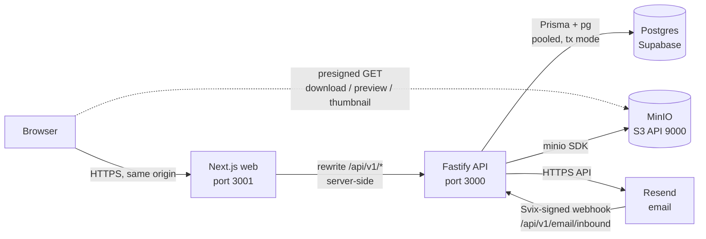
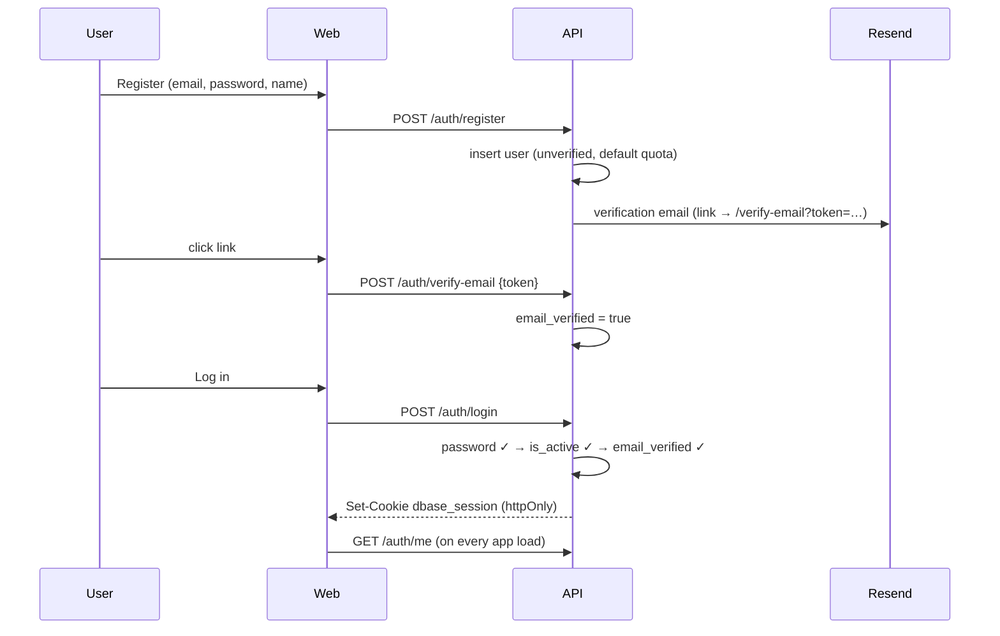

# DBase — Application Design Document

**Status:** v8 — rewritten from the code as built (2026-09-24). Every statement was derived from `src/`, `web/`, `scripts/`, `Dockerfile`s, `docker-compose.yml`, `.github/workflows/deploy.yml`, and `supabase/migrations/`. It replaces the earlier v7, which described a design that has since diverged from the code in many places.
**Scope:** The running system: architecture, backend modules, HTTP API, authentication and authorization, the key mechanisms (uploads, moves, trash, quotas, sharing), background workers, the web client, deployment, configuration, security posture, and a requirements traceability matrix.
**Related:** [DESIGN.md](./DESIGN.md) (database), [REQUIREMENTS.md](./REQUIREMENTS.md) (product requirements), [FRONTEND_DESIGN.md](./FRONTEND_DESIGN.md) (original client rationale; §10 below supersedes it where they differ), [IMPLEMENTATION_PHASES.md](./IMPLEMENTATION_PHASES.md) (original build sequencing).

**Conventions.** "As built" flags behavior that differs from REQUIREMENTS.md or from the original intent. §17 lists every such gap, ranked. Code references are relative to the repository root.

---

## Table of contents

1. Purpose and scope
2. System architecture
3. Technology stack
4. Backend architecture
5. Authentication and sessions
6. Authorization
7. HTTP API reference
8. Key mechanisms
9. Background workers
10. Web client
11. Deployment and operations
12. Configuration reference
13. Security considerations
14. Observability and operations
15. Testing
16. Requirements traceability
17. Known gaps and open items
18. Appendix: repository layout

---

## 1. Purpose and scope

DBase is a self-hosted, multi-user cloud file store, comparable to a small Dropbox or Nextcloud. Users get private quota-limited storage with nested folders, resumable uploads, sharing (to individuals and by public link), favorites, private tags, previews, and a recoverable trash. Admins get oversight tooling.

The system is a Fastify HTTP API (`src/`), a Next.js web app (`web/`), Postgres on Supabase for metadata, and MinIO for file bytes. It is designed for **one operator, one host, one backend instance** (§11.4).

### 1.1 Beyond REQUIREMENTS.md

The following exist in the code but were out of scope in REQUIREMENTS.md, or deferred there:

| Addition | Where |
|---|---|
| Email verification at signup (login refused until verified) | `accounts/service.ts`, migration 0017 |
| Folder download as a streamed ZIP, authenticated and via public links | `filesystem/folder-service.ts`, `access/share-link-service.ts` |
| System-wide storage cap and per-user quota **pre-allocation** | migrations 0015, 0022; `admin/user-admin-service.ts` |
| Admin-triggered object-store backup and restore | `admin/backup-service.ts`, `storage/client.ts` |
| Admin outbound mail and inbound mail (Resend webhook) | `admin/notify-service.ts`, `email/*` |
| Inline preview (image, video, audio, PDF) | `filesystem/file-service.ts` |
| Change password (signed-in), profile edit | `accounts/service.ts` |
| Storage breakdown charts (documents, images, videos) | `accounts/service.ts`, web `home`/`stats` |
| API rate limiting (REQUIREMENTS.md §3 deferred login rate limiting) | `server.ts` and route configs |

---

## 2. System architecture

### 2.1 Components



- The browser talks to **one origin** (the Next.js server). Next.js reverse-proxies `/api/v1/*` to the backend with a `rewrites()` rule. This is load-bearing: the session cookie is `SameSite=Lax`, and browsers do not send such cookies on cross-site `fetch`. Proxying makes every API call same-origin.
- **File bytes travel two different ways.** Uploads go browser → Next.js proxy → Fastify → MinIO (in 5 MiB parts). Downloads, previews and thumbnails go **directly** from MinIO to the browser via short-lived presigned URLs, so MinIO's S3 port must be reachable from browsers (`MINIO_PUBLIC_*`).
- Postgres is external (Supabase). The stack runs no database container.

### 2.2 Trust boundaries

| Boundary | Protection |
|---|---|
| Internet → Next.js | TLS terminated by the operator's reverse proxy or tunnel (not part of this repo) |
| Next.js → Fastify | Docker-internal network; no auth between them, the browser's cookie is forwarded by the rewrite |
| Browser → MinIO | Presigned URLs (300 s), bucket has no public policy |
| Resend → Fastify | HMAC-SHA256 Svix signature, 5-minute timestamp window, constant-time compare |
| Fastify → Postgres | Connection string secret; RLS on with no policies, so anon-key API access is denied |

### 2.3 Request flow (typical authenticated call)

1. Browser calls `fetch("/api/v1/…", { credentials: "include" })`.
2. Next.js rewrite forwards to `BACKEND_URL` with the `Cookie` header.
3. Fastify: cookie plugin → global rate limit (§13.3) → body parser → route `preHandler` `requireSession` → JSON-schema validation → service function → response.
4. Errors are thrown as `AppError` and mapped by one global error handler to `{ error: { code, message } }`.

---

## 3. Technology stack

| Layer | Technology |
|---|---|
| Backend runtime | Node.js ≥ 18 (Docker: `node:22-slim`), TypeScript 5.7, ESM |
| HTTP framework | Fastify 5, `@fastify/cookie`, `@fastify/rate-limit` |
| Data access | Prisma Client 6 (`prisma/schema.prisma`), raw SQL via `pg`/Prisma for locks and bulk updates |
| Object store | MinIO (`minio` SDK 8), `quay.io/minio/minio` pinned release |
| Image / media | `sharp` (images), `ffmpeg` (video frames), `poppler-utils`/`pdftoppm` (PDF first page), all in the runtime image |
| Archive | `archiver` 8 (`ZipArchive`) for folder ZIPs |
| Password hashing | `bcryptjs` (cost 12) |
| Email | Resend HTTPS API (no SDK; plain `fetch`) |
| Frontend | Next.js 15 (App Router, `output: "standalone"`), React 19 |
| Client data layer | TanStack Query 5 |
| UI | Tailwind CSS 3, Radix primitives (`react-dialog`, `react-dropdown-menu`, `react-slot`), shadcn-style local components, `lucide-react` icons |
| Tests | Node's built-in test runner via `tsx` |
| CI/CD | GitHub Actions on a **self-hosted runner** |

---

## 4. Backend architecture

### 4.1 One deployable, modular monolith

A single Fastify process (`src/server.ts`) registers all route plugins and starts three in-process workers. There is no message broker, no separate worker deployment, and no shared cache. State lives in Postgres and MinIO.

```
src/
  server.ts            app setup, rate limiting, error handler, route registration, worker start
  config.ts            typed env config (fails fast on missing DATABASE_URL / MinIO keys)
  db.ts                one shared PrismaClient
  lib/                 password (bcrypt), tokens (random + SHA-256), email (Resend), emailTemplate
  modules/
    accounts/          register/verify/login/logout/sessions/reset/profile/storage usage
    access/            permission-check (the authorization primitive), permission-service, share-link-service
    filesystem/        folder-service, file-service, upload-service, normalize
    trash/             restore-service, deletion-queue-service
    organize/          favorite-service, tag-service
    search/            search-service
    thumbnails/        thumbnail-service, generate
    lifecycle/         deactivate / reactivate / delete account
    admin/             user-admin-service, audit-service, backup-service, notify-service
    email/             inbound-service (Svix verify + store)
    storage/           client.ts, the only module that touches MinIO
  workers/             upload-session-cleanup, deletion-queue, thumbnail-queue
scripts/               bootstrap-admin.ts, migrate.ts
```

### 4.2 Module responsibilities and dependency direction

| Module | Owns | Depends on |
|---|---|---|
| `accounts` | `users`, `sessions`, token tables; `AppError` base class | `lib/*` |
| `access` | `permissions`, `share_links`; `checkPermission` | `accounts`, `admin/audit`, `storage`, `filesystem` (zip, previewability), `thumbnails` |
| `filesystem` | `folders`, `files`, `upload_*` | `access`, `storage`, `thumbnails`, `admin/audit` |
| `trash` | `deletion_queue`; restore | `access`, `filesystem/errors`, `thumbnails`, `storage` |
| `organize` | `favorites`, `tags`, `item_tags` | `access`, `admin/audit` |
| `search` | search query | `db` only |
| `thumbnails` | `thumbnail_queue`; generation | `storage`, `access` |
| `lifecycle` | account lifecycle wrappers | `admin/audit`, Postgres functions |
| `admin` | stats, settings, backup, mail, audit | `accounts`, `lifecycle`, `storage`, `email` |
| `storage` | every MinIO call | `config` |

**The two rules that matter:**

1. **Every authorization decision goes through `access/permission-check.ts`.** No other module queries `permissions` to decide access. (Two known exceptions do so for *listing*, not authorization: `listSharedWithMe` and `search`.)
2. **Only `storage/client.ts` constructs or dereferences a storage key.** No other module talks to MinIO.

Cross-module coupling is looser than this layering suggests. For example, `access` imports from `filesystem` and `thumbnails`, and `filesystem` imports from `access`, so the module graph has cycles that ESM tolerates.

### 4.3 Request lifecycle and cross-cutting behavior

| Concern | Implementation |
|---|---|
| Body limit | 10 MiB (`server.ts`), above Fastify's 1 MiB default so 5 MiB raw upload parts fit |
| Content types | JSON (Fastify built-in), plus a registered `application/octet-stream` → `Buffer` parser for upload parts. The inbound-mail plugin overrides JSON parsing locally to keep the raw body for signature checking. |
| Session guard | `requireSession` preHandler: reads the cookie, resolves the session, attaches `request.session`. **Duplicated in each `routes.ts`** (accounts, filesystem, access, trash, organize, search, admin). A shared module was planned but never extracted. |
| Validation | Fastify JSON schemas on bodies and queries where present. Many routes (`PATCH /folders/:id`, `PATCH /files/:id`, admin `DELETE`) read the body with no schema. Validation failures map to `400 VALIDATION_ERROR`. |
| Error handling | One `setErrorHandler`: `AppError` → `{statusCode, {error:{code,message}}}`; Fastify validation → 400; anything else → logged and `500 INTERNAL_ERROR` |
| Serialization | `bigint` values are returned as **strings** in user-facing payloads, or as JS `Number` in admin aggregates and user rows (safe for single-host byte counts). |
| Logging | Fastify's built-in logger (`logger: true`); workers use `console` |
| Health | `GET /health` → `{status:"ok"}` (does not check Postgres or MinIO) |

### 4.4 Error model

Every error is `{ "error": { "code": string, "message": string } }`. Clients branch on `code`, never on the message.

| Status | Codes |
|---|---|
| 400 | `VALIDATION_ERROR`, `REGISTRATION_FAILED`, `WEAK_PASSWORD`, `INVALID_RESET_TOKEN`, `INVALID_VERIFICATION_TOKEN`, `NAME_TOO_LONG`, `PATH_TOO_LONG`, `NOT_A_FOLDER` (defined, unused), `INVALID_EMAIL`, `INVALID_SUBJECT`, `INVALID_BODY`, `INVALID_JSON` |
| 401 | `UNAUTHENTICATED`, `INVALID_CREDENTIALS`, `INVALID_PASSWORD` (share-link password), `INBOUND_NOT_CONFIGURED`, `INVALID_SIGNATURE` |
| 403 | `INSUFFICIENT_PERMISSION`, `ACCOUNT_DEACTIVATED`, `EMAIL_NOT_VERIFIED`, `REGISTRATION_CLOSED` |
| 404 | `NOT_FOUND`, `SESSION_NOT_FOUND`, `UPLOAD_SESSION_NOT_FOUND`, `NO_LONGER_AVAILABLE` |
| 409 | `NAME_COLLISION`, `CYCLE_DETECTED`, `UPLOAD_SESSION_INVALID`, `NOT_IN_TRASH`, `PURGE_IN_FLIGHT`, `LAST_ADMIN`, `NO_SYSTEM_ADMIN`, `SYSTEM_STORAGE_ALLOCATION_EXCEEDED`, `STORAGE_LIMIT_BELOW_ALLOCATION` |
| 422 | `QUOTA_EXCEEDED`, `SYSTEM_STORAGE_LIMIT_EXCEEDED` |
| 429 | `RATE_LIMITED` (global limiter, and share-link password throttle) |
| 500 | `INTERNAL_ERROR` |

**Existence hiding.** The filesystem, trash, organize and thumbnail services return `404 NOT_FOUND` when the caller lacks permission, so a user with no access cannot tell whether an item exists. The sharing endpoints (`permission-service`) return `403 INSUFFICIENT_PERMISSION` instead. Download and preview return `404 NO_LONGER_AVAILABLE`. The mix is intentional but not uniform.

`QUOTA_EXCEEDED` (the user's own quota) and `SYSTEM_STORAGE_LIMIT_EXCEEDED` (the shared cap) are deliberately distinct so the UI does not blame the user's quota for a full system.

### 4.5 Data-access strategy

Prisma is the default. Raw SQL is used only where Prisma cannot express the operation: advisory locks, `LIKE`-prefix subtree updates, recursive size and count queries, `ON CONFLICT … WHERE` partial-index upserts, `FOR UPDATE SKIP LOCKED` claims, the atomic conditional quota `UPDATE … RETURNING`, `ILIKE` search, and calls to the Postgres functions `transfer_ownership` and `delete_account`. The full list is in DESIGN.md §7.5.

Database errors are translated by message: services `includes()`-match `QUOTA_EXCEEDED`, `SYSTEM_STORAGE_LIMIT_EXCEEDED`, `LAST_ADMIN`, `SYSTEM_STORAGE_ALLOCATION_EXCEEDED`, `STORAGE_LIMIT_BELOW_ALLOCATION`, `INSUFFICIENT_PERMISSION`, `OWNER_NOT_FOUND`, or the Prisma code `P2002` (unique violation), and rethrow as `AppError`.

---

## 5. Authentication and sessions

### 5.1 Credentials and tokens

| Item | Design |
|---|---|
| Password | ≥ 8 characters (API `minLength` plus `isPasswordStrongEnough`); bcrypt cost 12 |
| Session token | 32 random bytes, base64url, sent as a cookie; **SHA-256 hash** stored in `sessions.refresh_token_hash` |
| Cookie | Name `dbase_session` (`SESSION_COOKIE_NAME`); `httpOnly`, **`secure: true` always**, `sameSite: lax`, `path: /`, expires with the session |
| Session lifetime | `SESSION_TTL_DAYS` (default 30), **fixed**, not extended by activity |
| Reset / verification tokens | 32 random bytes; hashed at rest; single use; 30 min and 24 h |

`secure: true` is unconditional. It works on `http://localhost` (browsers treat localhost as a secure context) but a deployment served over plain HTTP on any other host will silently lose its cookie. TLS in front of the frontend is required.

### 5.2 Flows



- **Registration** inserts the user with the default quota. If the system is fully allocated, the pre-allocation trigger rejects the insert and the API returns `REGISTRATION_CLOSED`. An existing, **verified** email returns a generic `REGISTRATION_FAILED`. An existing, **unverified** email has its password and name overwritten and gets a fresh verification email.
- **Login** checks, in order: user exists → password matches → `is_active` → `email_verified`. The first two failures return the same `INVALID_CREDENTIALS`. Deactivation and unverified status are revealed only after a correct password, so they do not enable email enumeration.
- **Session resolution** (`resolveSession`, every authenticated request): hash the cookie → load the session with its user → reject if revoked, expired, or the user is inactive. One DB round trip per request.
- **Logout** revokes exactly the session behind the presented cookie. **Device list** (`GET /auth/sessions`) shows active sessions; `DELETE /auth/sessions/:id` revokes one owned by the caller.
- **Change password** (signed in) verifies the current password, sets the new hash, and revokes **every other** session while keeping the current one.
- **Password reset** is non-enumerating: the request always answers the same message. Confirming sets the new hash, marks the token used, and **revokes all sessions**.
- **Resend verification** is likewise non-enumerating.
- **Email delivery.** If `RESEND_API_KEY` is unset, `sendEmail` logs the message (including the link) to the backend console instead of sending, so flows work end to end in development.

### 5.3 Bootstrapping the first admin

There is deliberately no HTTP endpoint for it. `npm run bootstrap:admin -- --email=… --password=… --name=…` (`scripts/bootstrap-admin.ts`) refuses to run if any admin already exists and upserts the account with `role = admin` and the default quota. Further admins are promoted through the admin API.

**As built, the script does not set `email_verified`, so the bootstrapped admin cannot log in** until that flag is set (e.g. by SQL). See §17 #2.

### 5.4 Deactivation and deletion

- **Deactivate** (admin): sets `is_active = false`, revokes all the user's sessions, and logs. Nothing else is mutated. Effects follow from live checks: sessions stop resolving, the user's public links stop working (creator-active check), and grants the user made stop counting (granter-active check).
- **Reactivate**: sets `is_active = true`. Everything resumes with no other write.
- **Delete**: `delete_account()` (DESIGN.md §6.7). See §8.9.

---

## 6. Authorization

### 6.1 Layers

1. **Authentication**: a valid session (`requireSession`).
2. **Admin gate**: every `/admin/*` route additionally uses `requireAdmin` (session + `role = admin`), returning `403 INSUFFICIENT_PERMISSION` otherwise.
3. **Item permission**: `checkPermission(userId, itemType, itemId, requiredRole)` in `access/permission-check.ts`. The admin role short-circuits to *allow* before any lookup. Otherwise the highest role from the direct grant and every ancestor folder grant wins. See DESIGN.md §8.2 for the algorithm.

### 6.2 Who can do what

| Action | Requires |
|---|---|
| List folder contents, download, preview, thumbnail, favorite, list own tags on an item | `viewer` |
| Create in a folder, rename, move, trash, restore, purge, upload into a folder, tag | `editor` (moves also need `editor` on the destination) |
| Grant or revoke access, create or list share links and collaborators | `editor`, and a grant may not exceed the actor's own role |
| Transfer ownership | Current owner, or an admin |
| Revoke a share link | The link's own **creator** (not the owner, unless they created it) |
| Quota, role, deactivate, system limit, backup, mail, stats | Admin |

### 6.3 Sharing rules as implemented

- **Grant:** self-grant and granting to the item's owner are silent no-ops. Granting to someone with an existing grant keeps the **higher** of the two roles. The grantee id is not validated up front, so a nonexistent id surfaces as a generic 500 (the UI resolves emails through `/users/lookup` first).
- **Revoke:** deletes non-owner grants; the owner row can never be touched here.
- **Dynamic folder sharing:** a folder grant applies to everything currently inside it and anything added later, because resolution walks ancestors at check time.
- **Highest wins** across direct and inherited grants.
- **Public links:** see §8.7.

### 6.4 Admin bypass

Because the bypass lives inside `checkPermission`, admins can read, download, move and trash anyone's items through the *ordinary* endpoints, as well as through `/admin/users/:id/files`. Auditing differs by path: the admin browse endpoint logs `view` (once per 30 minutes per admin-and-user pair). Ordinary endpoints log their normal action (`download`, `rename`, …) with the admin as `actor_id` and the item owner as `subject_user_id`. Passive reads through ordinary listing endpoints are not logged.

---

## 7. HTTP API reference

Base path `/api/v1`. JSON in and out unless stated. "Auth" is *session* (cookie), *admin* (session + admin role), or *public*. Success bodies are shown compactly. Errors always use §4.4's shape.

**Rate limits** (details in §13.3): the global default is 300 requests per minute per session; "unauth" routes are limited to 20 per 15 minutes per source address; "write" routes to 60 per minute; "backup" routes to 3 per 10 minutes; "none" is exempt from the route-level limit (the global limiter still applies unless noted).

### 7.1 Accounts and sessions (`accounts`)

| Method and path | Auth | Rate | Body / query | Success |
|---|---|---|---|---|
| `POST /auth/register` | public | unauth | `{email, password(≥8), displayName}` | 201 `{user:{id,email,display_name,created_at}}` |
| `POST /auth/login` | public | unauth | `{email, password}` | 200 `{user:{id,email,displayName,role}}` + `Set-Cookie` |
| `POST /auth/logout` | session | | | 204, cookie cleared |
| `GET /auth/me` | session | | | `{user:{id,email,displayName,role}}` |
| `POST /auth/verify-email` | public | global | `{token}` | `{message}` |
| `POST /auth/resend-verification` | public | unauth | `{email}` | `{message}` (always) |
| `POST /auth/password-reset/request` | public | unauth | `{email}` | `{message}` (always) |
| `POST /auth/password-reset/confirm` | public | global | `{token, newPassword}` | `{message}` |
| `POST /auth/change-password` | session | | `{currentPassword, newPassword}` | 204 |
| `GET /auth/sessions` | session | | | `{sessions:[{id,device_info,created_at,expires_at}]}` |
| `DELETE /auth/sessions/:sessionId` | session | | | 204 or `SESSION_NOT_FOUND` |
| `GET /users/me/storage` | session | | | `{storageUsedBytes, storageQuotaBytes}` (strings) |
| `GET /users/me/storage-breakdown` | session | | | `{categories:[{category: documents\|images\|videos, bytes}]}` |
| `GET /users/lookup?email=` | session | | | `{user:{id,email,displayName}}` or `404` |
| `PATCH /users/me` | session | | `{displayName}` | `{user}` |
| `DELETE /users/me` | session | | | 204, cookie cleared (self-service deletion) |

`/users/lookup` reveals whether an email is registered. That is deliberate (sharing needs it) but usable for enumeration by any signed-in user.

### 7.2 Filesystem (`filesystem`)

| Method and path | Auth | Rate | Notes |
|---|---|---|---|
| `GET /folders/contents` | session | | Caller's root: their own root folders and files |
| `GET /folders/:id/contents` | session | | Needs `viewer`. Returns `{folder:{id,name,parentFolderId}, ancestors:[{id,name}], items}` |
| `POST /folders` | session | write | `{name, parentFolderId?}` → 201 `{folder}` |
| `PATCH /folders/:id` | session | write | `{name?, parentFolderId?}` (rename and/or move) → `{folder}` |
| `DELETE /folders/:id` | session | write | Trash the subtree → 204 |
| `GET /folders/:id/download-zip` | session | none | Streamed `application/zip`, needs `viewer` |
| `PATCH /files/:id` | session | write | `{name?, folderId?}` → `{file}` |
| `DELETE /files/:id` | session | write | Trash → 204 |
| `GET /files/:id/download` | session | | `{url}` presigned, 300 s; logs `download` |
| `GET /files/:id/preview` | session | | `{available:true,url,mimeType}` or `{available:false}` |
| `GET /files/:id/thumbnail` | session | | `{available:true,url}` or `{available:false}` |
| `POST /files` | session | write | Start upload: `{targetFolderId?, targetName, totalParts}` → 201 `{uploadSessionId, expiresAt}` |
| `PUT /files/upload-sessions/:id/parts/:n` | session | none | Raw `application/octet-stream` body (≤ 10 MiB); `n` is **0-based** → 204 |
| `POST /files/upload-sessions/:id/complete` | session | | `{mimeType?}` → `{file}` |
| `DELETE /files/upload-sessions/:id` | session | | Cancel → 204 |

Folder-content items are `{id,name,type,updatedAt}` plus, for files, `sizeBytes` and `mimeType`, and for folders, recursive `sizeBytes` and `fileCount`. Items in a listing are sorted with folders first, then by name, on the server. The web client re-sorts and filters client-side (§10.5).

### 7.3 Sharing (`access`)

| Method and path | Auth | Notes |
|---|---|---|
| `POST /items/:type/:id/permissions` | session | `{userId, role: viewer\|editor}` → 204. `:type` is `file` or `folder`. |
| `DELETE /items/:type/:id/permissions/:userId` | session | 204 |
| `GET /items/:type/:id/permissions` | session | `{collaborators:[{userId,email,displayName,role}]}`, needs `editor` |
| `GET /shared-with-me` | session | `{items:[{id,type,name,role}]}`: **direct grants only** |
| `POST /items/:type/:id/transfer-ownership` | session | `{newOwnerId}` → 204 (owner or admin) |
| `POST /items/:type/:id/share-links` | session | `{role, password?, expiresAt?}` → 201 `{token,id}` |
| `GET /items/:type/:id/share-links` | session | `{links:[{id,token,role,hasPassword,expiresAt,createdBy,createdAt}]}`, needs `editor` |
| `DELETE /share-links/:id` | session | Creator only → 204 |
| `GET /public/share-links/:token` | public | `?password=&folderId=` → `{name,role,folderId,parentFolderId,isRoot,items}` |
| `GET /public/share-links/:token/files/:fileId/download` | public | `?password=` → `{url}` |
| `GET /public/share-links/:token/files/:fileId/preview` | public | `{available,…}` |
| `GET /public/share-links/:token/files/:fileId/thumbnail` | public | `{available,url?}` |
| `GET /public/share-links/:token/folders/:folderId/download-zip` | public | Streamed ZIP, rate limit none |

Public routes pass the password as a **query parameter** (§13.5).

### 7.4 Trash (`trash`)

| Method and path | Auth | Rate | Notes |
|---|---|---|---|
| `GET /trash` | session | | `{items:[{id,name,type,deletedAt}]}`: everything the caller **owns** that is trashed, each descendant listed individually |
| `POST /trash/:type/:id/restore` | session | write | Needs `editor`; refused with `PURGE_IN_FLIGHT` if a purge is queued |
| `DELETE /trash/:type/:id` | session | write | "Delete forever": enqueue purge; item must be trashed (`NOT_IN_TRASH`) |

### 7.5 Organize and search

| Method and path | Auth | Rate | Notes |
|---|---|---|---|
| `GET /favorites` | session | | Lazily pruned list (DESIGN.md §8.4) |
| `POST` / `DELETE /items/:type/:id/favorite` | session | write | Idempotent; 204 |
| `GET /tags` | session | | `{tags:[…]}` (own only) |
| `POST /tags` | session | write | `{name, color?}` → 201 `{tag}`; duplicate name → `NAME_COLLISION` |
| `PATCH /tags/:id` | session | write | `{color}` only; no rename |
| `DELETE /tags/:id` | session | write | Cascades to `item_tags` |
| `GET /tags/:id/items` | session | | Live, visible items carrying the tag |
| `GET /items/:type/:id/tags` | session | | The caller's own tags on the item |
| `POST /items/:type/:id/tags` | session | write | `{tagId}`; needs `editor` on the item and ownership of the tag |
| `DELETE /items/:type/:id/tags/:tagId` | session | write | Needs only ownership of the tag |
| `GET /search?q=` | session | | Up to 50 results, name `ILIKE '%q%'`, ordered by name; owned items and directly granted items only |

### 7.6 Admin (`admin`, all require the admin role)

| Method and path | Rate | Notes |
|---|---|---|
| `GET /admin/users` | | `{users:[{id,email,displayName,role,isActive,storageUsedBytes,storageQuotaBytes}]}` (numbers) |
| `PATCH /admin/users/:id/quota` | write | `{quotaBytes: integer ≥ 0}` → 204. Limited by unallocated system storage. |
| `PATCH /admin/users/:id/role` | write | `{role: user\|admin}` → 204. Last-admin protected. |
| `POST /admin/users/:id/deactivate` | write | 204 |
| `POST /admin/users/:id/reactivate` | write | 204 |
| `DELETE /admin/users/:id` | write | Optional `{replacementOwnerId}` (one user receives **all** items); 204 |
| `GET /admin/users/:id/files` | | `?folderId=` browse a user's files. Logs `view`. |
| `GET /admin/users/:id/storage-breakdown` | | Same shape as the user's own |
| `GET /admin/stats` | | `{totalUsers, totalStorageUsedBytes}` |
| `GET /admin/system-storage` | | `{totalStorageLimitBytes, totalStorageUsedBytes, totalStorageAllocatedBytes, defaultUserQuotaBytes}` |
| `PATCH /admin/system-storage` | write | `{totalStorageLimitBytes}` → 204. Cannot go below allocated quotas. |
| `PATCH /admin/system-storage/default-quota` | write | `{defaultUserQuotaBytes}` → 204. Quota for accounts registered afterwards; cannot exceed the system limit. |
| `GET /admin/system-storage-breakdown` | | System-wide category breakdown |
| `GET /admin/activity` | | Latest **200** `{id,action,actorId,subjectUserId,createdAt}` |
| `GET /admin/failed-jobs` | | Deletion-queue rows stuck in `failed` |
| `POST /admin/backup` | backup | Copy the whole bucket into a new backup bucket |
| `GET /admin/backups` | | Available backup buckets, newest first |
| `POST /admin/backups/:name/restore` | backup | Copy a backup bucket's objects over the live bucket |
| `POST /admin/send-email` | write | `{to, subject, body}` (plain text, HTML-escaped) |
| `GET /admin/received-emails` | | Latest 200 inbound messages + inbound address |

### 7.7 Email webhook and health

| Method and path | Auth | Notes |
|---|---|---|
| `POST /email/inbound` | Svix signature | Rejects everything with 401 when `RESEND_WEBHOOK_SECRET` is unset. Ignores non-inbound event types with 204. Idempotent on `Message-ID`. |
| `GET /health` | public | `{status:"ok"}` |

---

## 8. Key mechanisms

### 8.1 Name handling and path limits

Every name is NFC-normalized and trimmed before use, and rejected if empty or over 255 UTF-8 bytes (`normalize.ts`). Create, rename, move and upload also check that the root-to-item name path stays within 4096 bytes by walking `parent_folder_id` upward, one query per level. Sibling collisions are detected by the database's unique index and mapped to `NAME_COLLISION`. The upload path additionally pre-checks for a live same-named file, to fail before any bytes move.

### 8.2 Folder move (highest-risk operation)

```
moveOrRenameFolder(user, folder, {name?, parentFolderId?}):
  load folder (live) ; require editor on folder                       (else 404)
  if reparenting: reject parent == self (CYCLE_DETECTED)
                  require editor on the new parent
  check name/path budget
  transaction:
    if rename only: UPDATE name
    else:
      pg_advisory_xact_lock(hashtext(a), hashtext(b))   # a,b = sorted(folderId, newParentId)
      (root target: single-key lock on folderId)
      re-read the folder inside the lock
      target parent must be live; if target == folder or target.materialized_path
          contains "/<folderId>/"  → CYCLE_DETECTED
      UPDATE folder (name, parent, materialized_path = targetPath + id + "/")
      UPDATE descendants: materialized_path = newPrefix || substring(old, len(oldPrefix)+1)
  log move|rename
```

Locking both ids in sorted order prevents two opposing moves from both passing the cycle check (DESIGN.md §7.4). The subtree rewrite happens in the same transaction, so descendant paths are never stale after a move.

**As built:** the second half of REQUIREMENTS.md's move-authorization rule is missing. An editor who is not the owner can move a shared item somewhere that removes other users' access. File moves are simple updates of `folder_id` with the same permission checks, and the same gap.

### 8.3 Upload pipeline

The client cuts the file into **5 MiB** parts, uploads them through the backend, and finalizes. The design points:

- **Charge as you go.** Each part atomically increments the owner's `storage_used_bytes` only if it stays within quota (`UPDATE … WHERE used + Δ ≤ quota RETURNING`). Over quota → `QUOTA_EXCEEDED` at that part, not after assembly. The system-cap trigger can raise `SYSTEM_STORAGE_LIMIT_EXCEEDED`. If the storage write fails after charging, the charge is refunded immediately.
- **Idempotent parts.** A retried part number already recorded is a no-op with no double charge.
- **Destination guard.** Before every part and at completion, the destination folder must still be live and writable, and the target name must still be free, else the session is aborted (`UPLOAD_SESSION_INVALID`, quota credited back). A concurrent rename, trash or collision cannot make an upload land somewhere unexpected.
- **Finalize.** All `total_parts` parts must be present. The `files` row is inserted (`complete`), the parts are composed server-side into `files/<random>`, temp parts are removed, the owner permission is inserted, a thumbnail is enqueued when the type is image, video or PDF, and `upload` is logged.
- **Abort** (cancel, expiry, failed finalization): credit back the sum of accepted parts, delete temp objects, mark the session `aborted`. Expired sessions are aborted by a worker every 5 minutes.
- **Pre-flight failure** returns before any bytes: a name collision on init is rejected immediately.

Limits and caveats: the expiry is fixed at session creation (default 60 min) and is not extended by progress, so a very large upload on a slow link can expire mid-transfer. Part numbers are 0-based. The `files` row is inserted before composition, so a compose failure leaves a row without a blob (§17 #11).

### 8.4 Download, preview and thumbnails

All three return **presigned MinIO URLs** built against the public endpoint, valid 300 seconds. Authorization and liveness (`deleted_at IS NULL`, `upload_status = 'complete'`) are checked once when the URL is issued. An in-flight transfer may finish after a rename, move or trash (the object is immutable). New requests after trashing fail at once with `NO_LONGER_AVAILABLE`.

- Downloads set `Content-Disposition: attachment; filename*=UTF-8''…` and log `download`.
- Previews use `inline` and override the content type. They are offered for `image/*`, `video/*`, `audio/*`, and `application/pdf`; anything else yields `{available:false}`, a normal state rather than an error. Previews are not logged as downloads.
- **Thumbnails** (`image/*`, `video/*`, PDF) are generated in the background (§9.3). `{available:false}` covers not-thumbnailable, still generating, and failed alike.
- **Folder ZIP:** built lazily with `archiver` (compression level 9). Each file streams from MinIO into the archive as it is appended, so a large folder does not sit in memory. The response starts immediately. Access is `viewer` on the top folder only. Descendants are authorized structurally. Trashed items are excluded. The public variant enforces link scope instead of a user check.

### 8.5 Trash, restore and purge

- **Trash** sets `deleted_at` on the item, or on the whole subtree for a folder, in one transaction. Trashed items still count against quota.
- **Restore** puts an item back in its original parent if that parent is live, otherwise at the owner's root. A folder restore also revives every descendant that is still trashed and not mid-purge. Files without a ready thumbnail are re-enqueued. **Defect:** re-parenting to root does not rewrite the folder's `materialized_path`, which can later cause a live folder to be purged (§17 #1).
- **Purge** ("delete forever" or the hourly 30-day scan) enqueues `deletion_queue` rows through an idempotent guard. The worker deletes blobs, then in one transaction removes the item and its polymorphic references and credits quota back. Five failed attempts park a row as `failed` for the admin page.
- Each item's 30-day clock is independent. A descendant force-deleted early is not resurrected by restoring an ancestor.
- `GET /trash` lists **every** trashed item the caller owns, including each descendant of a trashed folder as its own row.

### 8.6 Storage accounting

Three limits interact (DESIGN.md §9): per-user quota, per-user usage, and a system-wide limit that also **pre-allocates** quotas. The application layer contributes the atomic per-part charge (§8.3) and the translation of database exceptions into the distinct errors in §4.4. Admin rules:

- Quota may be set to 0 and lowered below usage. Raising it is bounded by unallocated system storage (`SYSTEM_STORAGE_ALLOCATION_EXCEEDED`, with the maximum available reported in GB).
- The system limit may not fall below total allocated quotas (`STORAGE_LIMIT_BELOW_ALLOCATION`).
- New registrations start with the default quota (`system_settings.default_user_quota_bytes`, set by an admin; `DEFAULT_USER_QUOTA_BYTES`, 15 GiB, until one is set) and are refused when unallocated space cannot cover it.
- The UI displays quotas in decimal gigabytes (×1e9) on admin pages, while defaults are binary GiB (15 × 1024³). Values round-trip approximately.

### 8.7 Public share links

Creation requires `editor` and a role not above the creator's own. The token is 32 random bytes (base64url). A password, if given, is bcrypt-hashed. `expiresAt` is optional.

Every public request runs `resolveShareLink`:

1. Link exists; **its creator is active**; not expired (all failures look identical: `404 NOT_FOUND`).
2. If password-protected: apply the per-token throttle (10 consecutive failures in a 15-minute window locks the token out, even for the correct password, until the window lapses), then verify. A missing password counts as a failure.
3. Then `isWithinSharedScope` confines the request to the linked subtree. A visitor can browse down from the linked folder, never above it. `parentFolderId` is null at the root so the UI shows no "up" link.

A file-type link lists just that one file. Public routes offer only browse, download, preview, thumbnail and ZIP. There is no public write, so `editor` links currently equal `viewer` links (§17 #9). Creators can list links on an item; only the creator can revoke one.

### 8.8 Favorites, tags, search

- **Favorites** require `viewer` and a live item; toggling is idempotent. The list is resolved lazily and stale rows are deleted on read (deviation from REQUIREMENTS.md §5.7 for reversible loss, §17 #5).
- **Tags** are private per user (unique by `(owner, name)`). Applying needs `editor` on the item and ownership of the tag; removing needs only tag ownership; `GET /tags/:id/items` silently skips items that no longer resolve.
- **Search** is a single `ILIKE '%term%'` over files and folders, unioned, ordered by name, limited to 50, live items only, over items the caller owns or is **directly** granted. Items reachable only through a shared ancestor are not found (§17 #5).

### 8.9 Account lifecycle

- **Deactivate / reactivate:** §5.4.
- **Delete:** the API resolves the replacement owner (self-service: oldest active admin other than the user; admin: the given `replacementOwnerId` or that default), then calls `delete_account()`. It logs `account_delete` afterwards with email, display name and the new owner, since the user row is gone. No admin available returns `NO_SYSTEM_ADMIN`. Deleting the last admin returns `LAST_ADMIN`.
- **Effects of deletion:** the user's owned items pass to the replacement (with byte accounting), their shares, links, tags, favorites, sessions and pending uploads disappear, and activity history is preserved.

### 8.10 Activity logging

`logActivity` writes one row per meaningful action with actor and subject. It is called *after* the action succeeds and outside its transaction, so a crash between the two can lose a log row. Admin `view` events are de-duplicated with a 30-minute window per pair. Actions and their subjects follow DESIGN.md §5.13. Item-level rows are kept forever. The admin activity endpoint returns the newest 200 with no filtering, and the stats page derives its charts from that same window.

### 8.11 Backup and restore

`POST /admin/backup` creates a bucket `dbase-backup-<timestamp>` and server-side-copies every object into it, logging `backup_run` with the count. `POST /admin/backups/:name/restore` re-validates the name against the current backup list, copies every object back over the live bucket without deleting extras, and logs `backup_restore`. Both are limited to 3 per 10 minutes. **They cover objects only, not Postgres**, so they are not a complete backup (§17 #13). They also run synchronously inside one HTTP request, which can time out on large stores.

### 8.12 Inbound and outbound email

- **Outbound** uses Resend's HTTPS API through a single `sendEmail` function, wrapped in a branded HTML shell (`emailTemplate.ts`). Admin-composed mail is plain text, HTML-escaped, with paragraph breaks preserved.
- **Inbound:** Resend delivers `email.received` webhooks (metadata only). The handler verifies the Svix signature over the raw bytes, then calls Resend's receiving API to fetch the body, headers and attachment list, and stores a row (`received_emails`). Duplicates are ignored, but a redelivery that now carries a body backfills the earlier metadata-only row. Attachment **bytes are not stored**. The admin page renders HTML bodies in a fully sandboxed `<iframe sandbox="">`.

---

## 9. Background workers

All workers are `setInterval` loops inside the API process, started after the server begins listening. Each has an in-memory overlap guard so a slow tick is never re-entered. There is no leader election. **Running two backend replicas would double-run the timers.** The claim queries use `SKIP LOCKED`, so queue processing itself is safe, but the upload-session cleanup and the retention scan are not designed for concurrency (§11.4).

| Worker | Interval | Work | Retry / failure |
|---|---|---|---|
| `upload-session-cleanup` | 5 min | Abort `pending` sessions past `expires_at`: credit back, remove temp parts, mark `aborted` | Errors logged; next tick retries |
| `deletion-queue` (drain) | 60 s | Claim ≤ 20 `pending` rows → `processing`; remove blobs; transaction: delete references and item, credit quota, mark `done` | Up to 5 attempts, then `failed` (visible at `/admin/failed-jobs`) |
| `deletion-queue` (scan) | 60 min | Enqueue every live-trashed item older than `TRASH_RETENTION_DAYS` (30) | Idempotent guard makes repeats safe |
| `thumbnail-queue` | 30 s | Claim ≤ 10 rows; load source into memory; generate; **re-check the file is still live** before writing; store JPEG; mark file `ready` | Up to 3 attempts, then `failed`; file marked `failed` |

### 9.1 Deletion ordering guarantee

Blob removal comes first and is idempotent. A crash before the database transaction leaves the row `processing`. **Nothing re-claims `processing` rows**, so a crash after a claim strands that row until someone resets it manually (§17 #20). Quota is credited only in the same transaction that deletes the row, so accounting never goes ahead of reality.

### 9.2 Thumbnail generation

- **Images:** `sharp` resize to fit 320×320 (no enlargement), JPEG quality 70.
- **Video:** `ffmpeg -ss 1 -i … -frames:v 1`, 30-second timeout, then the same resize.
- **PDF:** `pdftoppm -jpeg -r 100 -f 1 -l 1` for page 1, 30-second timeout, then the same resize.
- The whole source object is read **into memory** before processing, which is expensive for large videos.
- An unsupported codec is an acceptable, silent `failed`, and the file remains fully usable.
- Restoring a file whose thumbnail is not `ready` re-enqueues generation. If it was already `ready`, it is simply served again.

### 9.3 Not implemented

The original design included an `effective_permissions` rebuild worker and a reconciliation/repair job for the denormalized values. Neither exists (§17 #8, #12).

---

## 10. Web client

The client is a Next.js 15 App Router app under `web/`, built as a standalone server.

### 10.1 Rendering strategy

Almost every page is a **client component**. The data is per-user and mutated in the same session, which is TanStack Query's domain, so server rendering would only add a round trip. The exceptions are the marketing landing page (server-rendered markup with a client-side redirect component for signed-in users) and the auth pages' shells.

### 10.2 Route map

| Route | Purpose | Main API calls |
|---|---|---|
| `/` | Landing page; redirects signed-in users to `/home` | none |
| `/login`, `/register` | Auth forms (login offers "resend verification") | `/auth/login`, `/auth/register`, `/auth/resend-verification` |
| `/verify-email` | Consume the emailed token | `/auth/verify-email` |
| `/password-reset/request`, `/confirm` | Reset flow | `/auth/password-reset/*` |
| `/s/[token]` | **Public** share page: password prompt, browse, preview, download, ZIP; list/grid, filter and sort | `/public/share-links/*` |
| `/home` | Storage-capacity card (ring chart), folder cards, recent files | `/users/me/storage`, `/storage-breakdown`, `/folders/*/contents` |
| `/folders`, `/folders/[folderId]` | The file browser | `/folders/*`, `/files/*`, `/favorites`, upload endpoints |
| `/search` | Name search | `/search`, `/favorites` |
| `/shared-with-me` | Items shared with the user | `/shared-with-me` |
| `/favorites` | Starred items | `/favorites` |
| `/tags` | Manage tags; browse items by tag | `/tags`, `/tags/:id/items` |
| `/trash` | Restore or delete forever | `/trash`, `/trash/:type/:id/*` |
| `/settings/sessions` | Device list and revoke | `/auth/sessions` |
| `/settings/account` | Profile, change password, delete account | `/users/me`, `/auth/change-password` |
| `/admin/users` | Users table: quota, role, deactivate/reactivate, delete | `/admin/users*` |
| `/admin/users/[userId]` | Browse a user's files (browse-only) | `/admin/users/:id/files` |
| `/admin/stats` | System charts, per-user breakdown | `/admin/system-storage*`, `/admin/users`, `/admin/activity` |
| `/admin/activity` | Activity table | `/admin/activity` |
| `/admin/system-storage` | View and edit the system limit and the default quota for new users | `/admin/system-storage*` |
| `/admin/backup` | Run backup, restore from a backup | `/admin/backup*` |
| `/admin/send-mail`, `/admin/received-mail` | Compose mail; read inbound mail | `/admin/send-email`, `/admin/received-emails` |
| `/admin/failed-jobs` | Failed deletion jobs | `/admin/failed-jobs` |

`/admin/failed-jobs` exists but is **not linked** from the sidebar (§17 #21).

### 10.3 Layout and gating

- `app/layout.tsx`: fonts, an inline script that sets `data-theme` before hydration (avoids a theme flash), and `Providers` (TanStack `QueryClient` with `retry: 1`, `staleTime: 30 s`, then `AuthProvider`).
- `(auth)/layout.tsx`: redirects **away** to `/home` if already signed in.
- `(app)/layout.tsx`: redirects **to** `/login` if not signed in; renders the sidebar (Home, My Files, Shared with me, Favorites, Trash; Search, Tags, Devices, Account; and, for admins, Users, Stats, Activity, Storage Settings, Backup, Send Mail, Received Mail), a quota indicator, the sign-out button, the theme toggle, and the `UploadProvider` and `UploadTray`.
- `admin/layout.tsx`: redirects non-admins to `/folders`.
- **Both gates are client-side only.** There is no middleware or server-side session check, so a signed-in user may briefly see the login form (and vice versa) before `AuthProvider` resolves. This is a cosmetic flash, not a security gap: data access is enforced by the API's own 401s.

### 10.4 State and data flow

- **Server state:** TanStack Query, keys centralized in `lib/query-keys.ts`. Mutations invalidate the queries they affect by hand (for example, a move invalidates the source and destination folder listings). This list is maintained manually.
- **Auth state:** `AuthProvider` holds the current user (from `GET /auth/me`). A global 401 handler clears it. **When the signed-in user id changes, every other query in the cache is reset**, so user B never sees user A's cached data on a shared browser tab.
- **Local UI state:** component state (dialogs, selection, filters). No global store.
- **No token storage:** the httpOnly cookie is invisible to JavaScript. `localStorage` holds only preferences (`dbase:theme`, `dbase:view-preference`) and upload-session ids (below).
- **API client** (`lib/api-client.ts`): the single place that builds requests. It prefixes `/api/v1`, sends `credentials: "include"`, parses the error envelope into a typed `ApiError(status, code, message, retryAfterSeconds)`, and calls the global 401 handler. Callers branch on `code`.

### 10.5 The file browser

`components/files/folder-browser.tsx` (about 800 lines) provides:

- List and grid views (persisted preference), breadcrumbs from the `ancestors` array, thumbnails for supported types.
- **Client-side** name search, type filter (all, folders, images, videos, audio, files) and six sort orders (name, size, modified). Folders always sort ahead of files. This satisfies the "sort by name or recency" requirement, but only over the rows the server already returned.
- Multi-select with bulk Move, Download (files only) and Delete.
- **Drag from the OS to upload** into the current folder, and **drag an item onto a folder to move it**.
- Row menu: Rename, Move (folder picker), Tags, Share, Download (folder → ZIP), Delete; a star toggle favorites an item and clicking a file opens the preview modal.
- Modals: New folder, Rename, Move, Share, Tags, New tag, and a File preview modal. The Share modal grants by email (resolved through `/users/lookup`), lists and revokes collaborators, creates and lists links (optional password and expiry) and transfers ownership.

### 10.6 Uploads (`lib/uploads.tsx`)

`UploadProvider` and the bottom-right `UploadTray` drive uploads:

- 5 MiB parts; at most **3 concurrent** uploads; per-task status (queued, uploading, paused, error, complete, canceled) with pause, resume, cancel and dismiss.
- **429 handling:** each request retries up to 5 times, waiting for `Retry-After` (or 5 s) plus jitter, unless the user paused.
- On any failure the client aborts the server session, so quota is released promptly.
- On completion it invalidates the storage-usage and destination-folder queries.
- **Resume after a page refresh is not implemented.** The upload session id is written to `localStorage` on creation and cleared on finish, but nothing reads it back. Pause and resume work only within the same page lifetime. Uploads in flight during a reload are abandoned and cleaned up by the server after expiry.

### 10.6.1 Public share page (`/s/[token]`)

A separate, unauthenticated experience in the same app. It asks for a password when the link requires one, browses the shared subtree with the same list/grid, filter and sort controls, previews and downloads files, and downloads a folder as ZIP. The password is remembered only in component state and re-sent as a query parameter on each request.

### 10.7 Styling and theming

Tailwind with local shadcn-style components (`components/ui`: button, input, password-input, select-menu, color-picker, ring and multi-ring charts). Two themes selected by `data-theme`: the default "alt" (warm amber skin) and "default". The choice is stored in `localStorage`.

---

## 11. Deployment and operations

### 11.1 Topology

One Ubuntu host runs everything under `docker-compose.yml`:

| Service | Image | Port | Notes |
|---|---|---|---|
| `backend` | built from `Dockerfile` | `PORT` (3000) | Loads `.env` wholesale (`env_file`) plus a few remapped variables. `depends_on` MinIO healthy. |
| `frontend` | built from `web/Dockerfile` | `FRONTEND_PORT` (3001) | Standalone Next.js server. |
| `minio` | `quay.io/minio/minio:RELEASE.2025-09-07T16-13-09Z` | `MINIO_PORT` (9000), console `MINIO_CONSOLE_PORT` (9001) | Data volume `minio-data`; SSE-S3 KMS key from env; healthcheck `mc ready local`. |
| `minio-init` | `quay.io/minio/mc:…` | none | One-shot: creates the `dbase` bucket and turns on default encryption (`mc encrypt set sse-s3`); idempotent. |

Postgres is **not** in the compose file: it is the external Supabase project.

### 11.2 Images

- **Backend** (multi-stage `node:22-slim`): `deps` (`npm ci`, `prisma generate`), `build` (`tsc`), `runtime`. The runtime installs `ffmpeg` and `poppler-utils` and ships **full** `node_modules` (including dev dependencies) so `tsx` can run `bootstrap:admin` and `migrate` inside the container. It copies `dist/`, `prisma/`, `scripts/` and `supabase/migrations/`. The Prisma generator lists both `native` and `debian-openssl-3.0.x` binary targets. Start command: `node dist/src/server.js`.
- **Frontend** (multi-stage): builds with Next's `standalone` output and copies only `.next/standalone`, `.next/static` and `public`. It sets `HOSTNAME=0.0.0.0` (otherwise Docker's auto-set `HOSTNAME` makes Next bind only the container's own IP and the published port refuses connections).

### 11.3 The reverse-proxy decision

`web/next.config.js` defines a `rewrites()` rule mapping `/api/v1/:path*` to `${BACKEND_URL}/api/v1/:path*`. It is a rewrite, not a hand-written route handler, because a rewrite forwards the request (including `Cookie`) unmodified by construction. **`rewrites()` is evaluated once at `next build`.** `BACKEND_URL` is therefore a **Docker build argument** (`docker-compose.yml` `build.args`, default `http://backend:${PORT}`), not a runtime variable. Changing the backend address requires rebuilding the frontend image. This was a real bug found by running the built containers.

The alternative of setting `SameSite=None` on the cookie was rejected: it would weaken CSRF posture for a problem the proxy solves cleanly.

### 11.4 Single-instance assumption

Rate limiting uses in-process memory and the workers use in-process timers with in-memory overlap guards. Both assume **exactly one backend process**. Horizontal scaling is out of scope. Doing it would need a shared rate-limit store, a single elected worker (or lock-guarded timers) and a reconsidered cleanup design.

### 11.5 Database migrations and CI/CD

- SQL migrations in `supabase/migrations/` are applied by `scripts/migrate.ts` in filename order, one transaction per file, recorded in a `_migrations` table. Re-running is a no-op.
- `.github/workflows/deploy.yml` (on push to `main`, `runs-on: self-hosted`):
  1. Checkout with `clean: false` (preserves the host's untracked `.env`).
  2. `docker compose build`.
  3. `docker compose run --rm backend npm run migrate` (runs *before* restart, so the schema is ready before new code serves traffic).
  4. `docker compose up -d --remove-orphans`.
  5. `docker image prune -f`.
- **There is no test, lint or typecheck step in CI**, and no rollback step. A failed migration aborts the deploy before restart, leaving the previous containers running. Migrations are forward-only, so a rollback of code that depends on a new migration must be done by hand.

### 11.6 First-time setup

1. Copy `.env.example` to `.env` and fill in Supabase URLs, MinIO credentials, the KMS key, public MinIO and app URLs, and (optionally) Resend keys.
2. `npm install && npm run migrate && npm run prisma:generate`.
3. `docker compose up --build`.
4. `docker compose exec backend npm run bootstrap:admin -- …` (see §5.3 for the caveat).

---

## 12. Configuration reference

All configuration comes from one repository-root `.env`, read by the backend (`dotenv`), by `docker-compose.yml` (auto-loaded), and by the frontend's build and dev scripts. `src/config.ts` fails fast when `DATABASE_URL`, `MINIO_ACCESS_KEY` or `MINIO_SECRET_KEY` is missing.

| Variable | Default | Meaning |
|---|---|---|
| `DATABASE_URL` | required | Supabase **pooled** (transaction mode, port 6543) connection string. Used by the app *and* migrations. |
| `DIRECT_URL` | | Direct (5432, IPv6-only) URL for `prisma db pull` only |
| `PORT` / `FRONTEND_PORT` | 3000 / 3001 | Each drives both container port and published host port |
| `SESSION_COOKIE_NAME` | `dbase_session` | |
| `SESSION_TTL_DAYS` | 30 | Session lifetime |
| `DEFAULT_USER_QUOTA_BYTES` | 16106127360 (15 GiB) | Quota for new accounts until an admin sets one in Storage Settings |
| `PASSWORD_RESET_TTL_MINUTES` | 30 | |
| `EMAIL_VERIFICATION_TTL_HOURS` | 24 | |
| `UPLOAD_SESSION_TTL_MINUTES` | 60 | Fixed upload-session lifetime |
| `TRASH_RETENTION_DAYS` | 30 | Per-item retention before automatic purge |
| `PUBLIC_APP_URL` | `http://localhost:3001` | Base for links in emails; **must** be the real public frontend URL in production |
| `RESEND_API_KEY` | unset | Unset means emails are logged, not sent |
| `EMAIL_FROM` | `onboarding@resend.dev` | Test domain only delivers to the account owner |
| `RESEND_WEBHOOK_SECRET` | unset | Unset means inbound webhook rejects everything (401) |
| `EMAIL_INBOUND_ADDRESS` | `dbase@nishit-db.com` | Display label only |
| `MINIO_ENDPOINT`, `MINIO_PORT`, `MINIO_USE_SSL` | `localhost`, 9000, false | Backend → MinIO (compose sets the host to `minio`). A scheme in the endpoint is stripped and infers SSL. |
| `MINIO_ACCESS_KEY`, `MINIO_SECRET_KEY` | required | Compose maps them from `MINIO_ROOT_USER` and `MINIO_ROOT_PASSWORD` |
| `MINIO_BUCKET` | `dbase` | Compose hardcodes `dbase`, so a different value in `.env` is ignored under Docker |
| `MINIO_PUBLIC_ENDPOINT`, `MINIO_PUBLIC_PORT`, `MINIO_PUBLIC_USE_SSL` | fall back to the internal values | The host a **browser** reaches MinIO on, used to sign presigned URLs. **Must be set for any non-local deployment.** |
| `MINIO_ROOT_USER`, `MINIO_ROOT_PASSWORD` | required (compose) | MinIO admin credentials |
| `MINIO_CONSOLE_PORT` | 9001 | |
| `MINIO_KMS_SECRET_KEY` | required (compose) | `name:base64(32 bytes)`; use a different key per environment; no rotation support |
| `BACKEND_URL` | `http://backend:${PORT}` | **Build-time** frontend proxy target |

---

## 13. Security considerations

### 13.1 Summary of controls

| Threat | Control |
|---|---|
| Credential theft from a database leak | bcrypt passwords; hashed session, reset and verification tokens |
| XSS reading the session | `httpOnly` cookie; no token in JS-accessible storage |
| CSRF | `SameSite=Lax`; state changes use non-GET methods; same-origin proxy. No CSRF tokens. |
| Unauthorized file access | Central `checkPermission`; non-guessable object keys; no public bucket policy; short-lived presigned URLs |
| Direct DB API exposure (Supabase) | RLS on, zero policies |
| Function search-path hijack | `search_path` pinned on all functions |
| Brute force on share-link passwords | Per-token throttle (10 per 15 minutes) |
| Forged inbound mail | Svix HMAC, timestamp window, constant-time compare, fail-closed when unset |
| Stored-HTML XSS from inbound mail | Rendered in a fully sandboxed iframe |
| Injection into admin outbound mail | Body HTML-escaped |
| Quota abuse and races | Atomic conditional update plus DB triggers |
| Last-admin lockout | DB trigger |

### 13.2 Data at rest

Object data is encrypted with MinIO SSE-S3 for objects written after it was enabled. Postgres encryption is Supabase's concern. Secrets live in `.env` on the host and are passed to containers through the environment.

### 13.3 Rate limiting

| Bucket | Limit | Key |
|---|---|---|
| Global default | 300 / minute | SHA-256 of the session cookie, else client IP |
| Unauthenticated routes (register, login, reset request, resend verification) | 20 / 15 minutes | Client IP |
| Write routes (folder/file mutations, trash restore and purge, favorites, tags, some admin) | 60 / minute | Session |
| Backup and restore | 3 / 10 minutes | Session |
| Upload part `PUT`, ZIP downloads | exempt from the route limit | Bounded by session lifecycle and folder size |

State is in process memory. `429` responses carry `Retry-After`, and the client honors it for uploads.

**Important limitation: the server does not enable Fastify's `trustProxy`.** Every request reaches Fastify through the Next.js rewrite, so `request.ip` is the frontend container's address for all users. All unauthenticated traffic, including logins from every real user and every anonymous share-link visitor, therefore shares **one** bucket: 20 login attempts per 15 minutes in total for the whole deployment, and 300 requests per minute across all public-link traffic. This is severe for any multi-user use (§17 #3). Fix: enable `trustProxy` for the frontend hop and have the rewrite forward `X-Forwarded-For`.

### 13.4 Accepted risks

- **Admin bypass** is total by design and only partly audited (§6.4).
- **`/users/lookup`** enables email enumeration by any signed-in user.
- **Presigned URLs** are bearer credentials for 5 minutes. A leaked URL grants access until it expires.
- **No MFA, no account lockout** beyond rate limits (explicit non-goals).
- **Sessions are fixed-lifetime** with no idle timeout or rotation.
- **A compromised host or operator** can read everything (documented trust model).

### 13.5 Known weaknesses to address

- Public share passwords travel in the **query string** (`?password=`), which is commonly logged by proxies and visible in browser history. Moving them to a header or POST body would fix it.
- The 404-versus-403 distinction is inconsistent across modules (§4.4).
- Backup and restore run synchronously in a request and act on the object store only.
- Rate-limit IP keying (§13.3).

---

## 14. Observability and operations

- **Logs:** Fastify request/error logs and worker `console` lines on the backend container's stdout (`docker compose logs backend`). Every worker tick that does work logs a count; permanent failures log an error with the item id.
- **Health:** `/health` is liveness only.
- **Admin visibility:** the activity page, the failed-jobs page (deletion queue), the system-storage page (limit, used, allocated) and the stats page.
- **Not present:** metrics, tracing, alerting, structured audit export, dashboards for the thumbnail queue, requeue tools for failed or stranded jobs.
- **Runbook notes:** bootstrap the first admin with the script (and fix `email_verified`, §5.3); back up Postgres separately from the object-store backup; keep the same `MINIO_KMS_SECRET_KEY` for the life of the data; set `MINIO_PUBLIC_*` and `PUBLIC_APP_URL` to real public values when deploying beyond localhost.

---

## 15. Testing

Tests use Node's built-in runner: `npm test` (`node --import tsx --test src/**/*.test.ts`). The only tests are unit tests in `src/lib/` (`password.test.ts`, `tokens.test.ts`). **There are no tests for services, routes, database functions, triggers, or the web client**, and CI does not run tests, lint or the frontend typecheck (`web`'s `typecheck` and `lint` scripts are not invoked). Concurrency-sensitive code (folder-move locking, quota races, queue claiming, ownership transfer) is therefore unverified by automation.

Suggested first targets, by risk: folder move race; quota race across parts; `transfer_ownership` and `delete_account`; restore, purge and path interaction (§17 #1); share-link throttle and scope; `resolveEffectiveRole` with deactivated granters.

---

## 16. Requirements traceability

Status: **Done** (matches), **Partial** (implemented with a gap), **Missing**, **Extra** (beyond requirements).

| REQUIREMENTS.md | Status | Notes |
|---|---|---|
| §5.1 Open registration, unique email, non-enumerating error, ≥ 8-char password, default quota | Done | Plus email verification (Extra) |
| §5.1 Multi-device sessions, per-device logout | Done | Sessions page |
| §5.1 Self-service password reset | Done | |
| §5.1 First-admin mechanism | Partial | Script exists; the admin it creates cannot log in (§17 #2) |
| §5.1 Deactivation (sessions, links, shares suspended; reversible) | Done | Live checks, not data changes |
| §5.1.1 Deletion with reassignment; default and admin-chosen owner | Done | Admin picks **one** replacement for all items, not per item |
| §5.2 Folders: nesting, name and path limits, uniqueness, cycle prevention | Partial | Uniqueness is per owner (§17 #6) |
| §5.3 Upload, multipart, cancel, destination guards | Done | |
| §5.3 Resume after interruption | Partial | Server supports it; client cannot resume after refresh (§10.6) |
| §5.3 Download, rename, move, name-collision rejection | Done | |
| §5.3 Move-authorization "no stripping others' access" | Missing | §17 #4 |
| §5.3 Search by name, partial and case-insensitive | Partial | Direct grants and owned only; 50-row cap |
| §5.4 Trash, restore, per-item 30-day clock, delete forever, restore-to-root | Partial | Defect in restore-to-root (§17 #1) |
| §5.5 Grant, revoke, immediate enforcement | Done | Synchronous resolution, no stale cache |
| §5.5 "Shared with me" including folder-inherited items | Partial | Direct grants only (§17 #5) |
| §5.5 Public links, password, expiry, throttle, creator-scoped lifetime | Done | |
| §5.5 Editor-level public links | Partial | Accepted but no write endpoints (§17 #9) |
| §5.5 Folder ZIP download | Extra | Was deferred in requirements |
| §5.5 Highest-permission-wins; ownership transfer | Done | |
| §5.6 Quotas: 0 valid, lower below usage, per-part enforcement, trash counts until purge | Done | Plus system limit and pre-allocation (Extra) |
| §5.7 Favorites, lazy visibility | Partial | Deleted, not hidden, on reversible loss (§17 #5b) |
| §5.8 Personal tags | Done | Rename not supported |
| §5.9 Thumbnails (image, video, PDF), background, delete-race safe, restore behavior | Done | |
| §5.10 Admin: view any files (logged), stats, quotas, roles, lifecycle, ownership | Done | |
| §5.10 Usage-frequency data | Partial | Aggregation function exists but no endpoint or page uses it |
| §5.11 Pagination | Missing | §17 #7 |
| §5.11 Explicit empty states | Done | Implemented in the UI |
| §5.11 Default sort by name, sort by recency | Done | Client-side |
| §5.12 Distinct quota vs permission errors | Done | Specific error codes |
| §5.13 Activity log with actor and subject | Done | Includes admin `view`, plus system and backup actions |
| §6 Deletion reliability with retry and surfacing | Done | Stranded `processing` rows are not recovered (§17 #20) |

---

## 17. Known gaps and open items

Ranked by severity. Items marked **defect** are reasoned from the code and should be reproduced before fixing. DESIGN.md §13 lists the data-layer view of the same issues.

| # | Severity | Item | Where and fix |
|---|---|---|---|
| 1 | **High, defect** | **Restore-to-root can lead to purging live data.** Re-parenting a folder to root on restore leaves its `materialized_path` pointing under the old ancestors. Later, purging that ancestor enqueues every path-prefixed folder (no `deleted_at` filter), including the restored live folder. Permissions also wrongly inherit from the old ancestors. | `trash/restore-service.ts` (rewrite subtree paths on re-parent) and `trash/deletion-queue-service.ts` (`enqueueFolderSubtreeForPurge`: restrict to trashed rows) |
| 2 | **High, defect** | **Bootstrapped admin cannot log in** because `email_verified` defaults to false. | `scripts/bootstrap-admin.ts`: set `email_verified: true` on create and update |
| 3 | **High** | **Rate limiter sees one client IP** (no `trustProxy`), so all unauthenticated users share one bucket; also affects public-link traffic. | `server.ts`: enable `trustProxy`; forward `X-Forwarded-For` from Next |
| 4 | Medium | Move can strip others' access (owner-only rule missing). | `folder-service.ts`, `file-service.ts` |
| 5 | Medium | (a) "Shared with me" and search ignore folder-inherited access. (b) Favorites deleted on reversible access loss. | `permission-service.ts`, `search-service.ts`, `favorite-service.ts` |
| 6 | Medium | Sibling-name uniqueness is per owner, not per folder. | Unique indexes (migration) and `upload-service` collision check |
| 7 | Medium | No pagination; hard caps on search (50), activity (200), mail (200). | All list endpoints |
| 8 | Medium | Every permission check is several uncached queries; `effective_permissions` is dead. Either build the cache or drop the table. | `permission-check.ts` |
| 9 | Low | Editor share links have no additional capability. | Decide: implement public write, or restrict link creation to viewer |
| 10 | Low | `usage frequency` aggregation is unused; stats derive from a 200-row activity window. | `audit-service.ts`, `admin/stats` |
| 11 | Medium | Upload finalization is not atomic across DB and object store. | `upload-service.completeUpload` |
| 12 | Medium | No reconciliation job for `storage_used_bytes` and `materialized_path`. | New worker |
| 13 | Medium | Backup covers the object store only, and runs inside a request. | `backup-service.ts`; add a `pg_dump` story |
| 14 | Medium | Upload session lifetime is fixed; slow large uploads can expire mid-flight. | Extend `expires_at` on each accepted part |
| 15 | Medium | Client cannot resume uploads after a refresh (session id stored, never read). | `web/lib/uploads.tsx` |
| 16 | Medium | Public share password in the query string. | Public routes and `/s/[token]` |
| 17 | Low | CI lacks tests, lint and typecheck; no rollback. | `.github/workflows/deploy.yml` |
| 18 | Low | `requireSession` duplicated across seven route files. | Extract to a shared module or Fastify decorator |
| 19 | Low | `GET /health` does not verify Postgres or MinIO. | `server.ts` |
| 20 | Medium | A worker crash after claiming leaves rows `processing` forever. Nothing resets stale claims or requeues `failed` rows. | Both queue services; add a lease timeout and an admin requeue action |
| 21 | Low | `/admin/failed-jobs` is not linked in the sidebar. | `web/app/(app)/layout.tsx` |
| 22 | Low | Unknown grantee id on `POST …/permissions` yields a 500 instead of a 404. | `permission-service.grantPermission` |
| 23 | Low | Inconsistent 404/403 semantics; a mix of string and numeric byte serialization in admin payloads. | API-wide |
| 24 | Low | Several file-header comments are stale (e.g. "no admin failed-deletions view yet", deactivation-aware favorites). | `deletion-queue-service.ts`, `favorite-service.ts` |
| 25 | Low | Docker-compose comments still say the storage module "isn't built." | `docker-compose.yml` |
| 26 | Info | Uncommitted work in the tree: migration 0022 (pre-allocation), quota-related admin and account changes, and admin-page edits. | `git status` |

---

## 18. Appendix: repository layout

```
.
├── docker-compose.yml       backend, frontend, minio, minio-init
├── Dockerfile               backend image (ffmpeg + poppler, full node_modules)
├── .github/workflows/deploy.yml
├── .env.example             the single config file for everything
├── package.json             backend deps and scripts (dev, build, start, test, migrate, bootstrap:admin, prisma:*)
├── prisma/schema.prisma     Prisma mirror of the DB (DDL truth is in supabase/migrations)
├── supabase/migrations/     0001 … 0022 (forward-only SQL)
├── scripts/                 bootstrap-admin.ts, migrate.ts
├── src/                     backend (see §4.1)
├── web/                     Next.js app
│   ├── app/                 routes: (auth), (app), s/[token], landing
│   ├── components/          files/ (browser, modals, tray), ui/ (primitives, charts)
│   ├── lib/                 api-client, auth, query-keys, uploads, formatting, hooks
│   ├── Dockerfile           standalone image (BACKEND_URL build arg)
│   └── next.config.js       output standalone + /api/v1 rewrite
└── docs/                    REQUIREMENTS, DESIGN (database), APPLICATION_DESIGN (this file),
                             FRONTEND_DESIGN, IMPLEMENTATION_PHASES
```

*When behavior changes, update the affected section here, the matching row in §16 and §17, and DESIGN.md if the schema is involved.*
