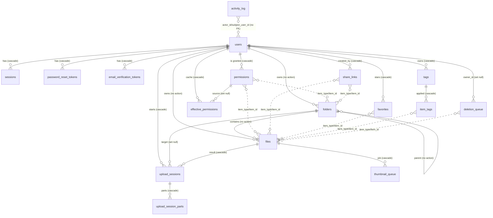

# DBase — Database Design Document

**Status:** v8 — rewritten from the code as built (2026-09-24). Every statement below was derived from `supabase/migrations/0001`–`0022`, `prisma/schema.prisma`, and the application code that reads and writes the schema. It replaces the earlier v7 document, whose review-pass history no longer describes the system.
**Scope:** The data model: tables, columns, constraints, triggers, database functions, indexes, the object-store key layout, and the invariants the application relies on.
**Not in scope:** HTTP API, workers, frontend and deployment. See [APPLICATION_DESIGN.md](./APPLICATION_DESIGN.md).
**Related:** [REQUIREMENTS.md](./REQUIREMENTS.md) (product requirements), [IMPLEMENTATION_PHASES.md](./IMPLEMENTATION_PHASES.md) (original build sequencing).

> **Source of truth.** `supabase/migrations/*.sql` is authoritative for DDL. `prisma/schema.prisma` is a query-builder mirror. It cannot express deferrable constraints, generated columns, or triggers, so **never run `prisma migrate` or `prisma db push`** against this database. Migrations are applied by `scripts/migrate.ts`.

**How to read the "as built" markers.** Where the implementation deviates from REQUIREMENTS.md or from the original intent, the text says so inline. §13 collects every deviation, ranked by severity.

---

## Table of contents

1. Purpose and scope
2. Design principles
3. Platform and conventions
4. Schema overview
5. Entity reference
6. Database-side logic (triggers and functions)
7. Cross-cutting patterns
8. Access-control data model
9. Storage accounting model
10. Object-store layout
11. Index catalog
12. Data lifecycle flows
13. Known deviations and defects
14. Migration history
15. Appendix: enum values

---

## 1. Purpose and scope

DBase is a self-hosted, multi-user cloud file store. This document defines where its metadata lives. Postgres holds metadata only. **File bytes never enter the database.** Files and thumbnails are objects in an S3-compatible store (MinIO), referenced by opaque keys.

### 1.1 What the schema models

| Capability | Tables |
|---|---|
| Accounts, login sessions, credential flows | `users`, `sessions`, `password_reset_tokens`, `email_verification_tokens` |
| Hierarchical file tree | `folders`, `files` |
| Resumable uploads | `upload_sessions`, `upload_session_parts` |
| Sharing and access control | `permissions`, `share_links`, `effective_permissions` (unused, §13) |
| Trash and permanent deletion | `folders.deleted_at`, `files.deleted_at`, `deletion_queue` |
| Personal organization | `favorites`, `tags`, `item_tags` |
| Previews | `files.thumbnail_*`, `thumbnail_queue` |
| Audit and admin statistics | `activity_log` |
| Deployment-level settings and mail | `system_settings`, `received_emails` |

### 1.2 Non-goals

- **No file version history.** Content is immutable for the life of a `files` row. Replacing content means delete plus re-upload.
- **No application-level encryption.** Encryption at rest is a storage-layer concern (MinIO SSE-S3, §10.3) and is invisible to the schema.
- **No groups or teams.** Every grant names one individual `user_id`, or is a public link.
- **No in-database authorization.** Row-level security is on but has zero policies (§12.7). All authorization is application-layer (`access.checkPermission`).

---

## 2. Design principles

1. **The database enforces what a single statement can enforce.** Uniqueness, non-negativity, name byte limits, the quota and system-limit triggers, last-admin protection, and owner-id write protection are database-enforced. Rules that need the acting user's identity (granting authority, move authorization, tag ownership) are application-layer and documented as such in column comments.
2. **Denormalize deliberately, and say what the source of truth is.** `users.storage_used_bytes` and `folders.materialized_path` are denormalized. Both have an explicit maintenance path (§7.3).
3. **No hidden cascades that can orphan blobs.** `folders`/`files` parent and owner FKs have *no* `ON DELETE` action, so a row can only disappear via the deletion worker after its blob is removed (§7.2).
4. **Secrets are hashed, never stored.** Session tokens, password-reset tokens, and email-verification tokens are stored as SHA-256 hashes. Passwords are bcrypt (cost 12). Share-link passwords are bcrypt. The public share `token` is the exception: it is stored in plaintext because it must be listable in the share dialog.
5. **Polymorphic references are cleaned by code, not by FKs.** `(item_type, item_id)` cannot carry a foreign key, so the deletion worker performs the cascade (§7.1).
6. **Concurrency is handled with atomic statements and transaction-scoped locks.** Examples are the conditional quota `UPDATE`, `SELECT … FOR UPDATE` on singletons, `pg_advisory_xact_lock` for folder moves, and `FOR UPDATE SKIP LOCKED` for queue claims. Session-scoped advisory locks are never used, which is what makes transaction-mode pooling safe (§3.2).

---

## 3. Platform and conventions

### 3.1 Platform

| Concern | Choice |
|---|---|
| Database | PostgreSQL, hosted on Supabase. The app does **not** run its own Postgres. |
| Extensions | `pgcrypto` (`gen_random_uuid()`); `pg_trgm`, relocated to a dedicated `extensions` schema in migration 0014 |
| Object store | MinIO (S3 API), bucket `dbase`, bucket-default SSE-S3 encryption |
| Client | Prisma Client (`@prisma/client` 6.x) for most access; raw SQL via `$queryRaw`/`$executeRaw` where Prisma cannot express the statement (§7.5) |
| Migration runner | `scripts/migrate.ts` (plain `pg` client, one transaction per file, tracked in a `_migrations` bookkeeping table) |

### 3.2 Connection strategy and why transaction pooling is safe

The running app connects through Supabase's Supavisor pooler in **transaction mode** (port 6543, `DATABASE_URL`). A direct connection (`DIRECT_URL`, port 5432) is used only for `prisma db pull`/`generate`. The direct host is IPv6-only, which the self-hosted deploy runner cannot reach, so **`npm run migrate` also uses `DATABASE_URL`**.

Transaction pooling breaks anything that depends on connection-level state. This schema avoids that class of bug:

- Advisory locks are always `pg_advisory_xact_lock`, which releases at commit or rollback.
- The transaction-local bypass flags (`dbase.bypass_quota_check`, `dbase.allow_owner_id_change`) are set with `set_config(name, value, true)`, where `true` means transaction-local, and are explicitly reset right after use.
- Migrations run each file in its own explicit `begin`/`commit`, so the pooler pins one backend for the whole file.

### 3.3 Naming and type conventions

- Tables and columns are `snake_case`. Prisma model names equal table names (`db.users`, `db.files`).
- Primary keys are `uuid` with `gen_random_uuid()`, except the composite-key join tables (`favorites`, `item_tags`, `effective_permissions`, `upload_session_parts`) and the `system_settings` singleton.
- Timestamps are `timestamptz`, defaulting to `now()`.
- Sizes are `bigint`. Prisma returns them as JS `BigInt`, which JSON cannot serialize, so the API converts to strings (or `Number` for admin aggregates) at the boundary.
- Enumerations are native Postgres enums (§15). `activity_action` is extended with `alter type … add value`.
- `permissions.item_type`, `share_links.item_type`, etc. share one `item_type` enum (`file`, `folder`).

### 3.4 Row-level security

All 19 tables have RLS enabled with **no policies** (migrations 0010, 0013, 0015, 0017, 0020). The app connects with a role that bypasses RLS. The effect is deny-by-default for Supabase's auto-generated PostgREST/GraphQL API, which this app never uses (it does not use Supabase Auth or the anon key). If anon or authenticated access is ever needed, it must be added with an explicit `CREATE POLICY`. RLS must not be disabled.

---

## 4. Schema overview

### 4.1 Table inventory

| Table | Rows represent | Migration |
|---|---|---|
| `users` | An account | 0001 (+0017 `email_verified`) |
| `sessions` | A logged-in device | 0001 |
| `password_reset_tokens` | An outstanding reset link | 0013 |
| `email_verification_tokens` | An outstanding verification link | 0017 |
| `system_settings` | The single deployment-wide settings row | 0015 |
| `folders` | A folder in the tree | 0002 |
| `files` | A file's metadata | 0002 |
| `upload_sessions` | An in-flight or finished multipart upload | 0002 |
| `upload_session_parts` | One completed part of an upload session | 0002 |
| `permissions` | A grant (owner/editor/viewer) of one user on one item | 0003 |
| `effective_permissions` | Resolved-access cache (**never used**) | 0003 |
| `share_links` | A public tokenized link to an item | 0003 |
| `deletion_queue` | A pending permanent-deletion job | 0004 |
| `favorites` | A user starring an item | 0005 |
| `tags` | A user's personal label | 0005 |
| `item_tags` | A tag applied to an item | 0005 |
| `thumbnail_queue` | A pending thumbnail-generation job | 0006 |
| `activity_log` | An append-only audit event | 0007 (+0016, 0018, 0019 enum values) |
| `received_emails` | An inbound message delivered to the deployment address | 0020, 0021 |

### 4.2 Entity-relationship diagram

Polymorphic references (`item_type`/`item_id`) are drawn as dashed relationships. They have no foreign key in the database.



---

## 5. Entity reference

Each entity lists its columns, constraints, indexes, and lifecycle. "App-layer" means the rule is enforced in code, not by the database.

### 5.1 `users`

One row per account.

| Column | Type | Notes |
|---|---|---|
| `id` | uuid PK | |
| `email` | text, not null, unique | Login identifier. Stored as typed (no case folding), so `A@x.com` and `a@x.com` are distinct accounts. |
| `password_hash` | text, not null | bcrypt, cost 12 |
| `display_name` | text, not null | |
| `role` | `user_role`, default `user` | `user` or `admin`. |
| `storage_quota_bytes` | bigint, default 0 | This user's pre-allocated capacity. Admin-editable only (app-layer). |
| `storage_used_bytes` | bigint, default 0 | Denormalized running total (§9). |
| `is_active` | boolean, default true | Reversible soft-disable. |
| `email_verified` | boolean, default **false** | Login is refused while false. Migration 0017 set it true for every pre-existing account. |
| `created_at`, `updated_at` | timestamptz | `updated_at` is bumped by the quota trigger. |

**Constraints:** `storage_quota_bytes >= 0`, `storage_used_bytes >= 0`.

**Triggers (all `BEFORE`):**

| Trigger | Event | Purpose |
|---|---|---|
| `trg_users_enforce_quota_on_increase` | UPDATE | Per-user quota (§6.1). Also sets `updated_at`. |
| `trg_users_enforce_system_storage_limit` | UPDATE | System-wide usage cap (§6.2). |
| `trg_users_enforce_quota_preallocation` | INSERT, UPDATE OF `storage_quota_bytes` | Sum of quotas ≤ system limit (§6.3). |
| `trg_users_last_admin_standing` | UPDATE, DELETE | Refuses to demote, deactivate, or delete the last active admin (§6.5). |

**Lifecycle notes**

- Registration inserts the row with `email_verified = false` and the default quota from `DEFAULT_USER_QUOTA_BYTES`. The preallocation trigger can reject the insert once the system is fully allocated, which the API surfaces as `REGISTRATION_CLOSED`.
- A re-registration against an existing **unverified** email overwrites that row's password hash and display name. This lets a mistyped signup be redone without an orphaned, unreachable row.
- Deletion is a hard `DELETE` performed only through `delete_account()` (§6.7). It cascades to `sessions`, `permissions` (as grantee), `share_links`, `favorites`, `tags` and `item_tags`, `upload_sessions`, `password_reset_tokens`, `email_verification_tokens`, and `effective_permissions`. `deletion_queue.owner_id` is set to null.

### 5.2 `sessions`

One row per logged-in device. Enables multi-device login and per-device logout.

| Column | Type | Notes |
|---|---|---|
| `id` | uuid PK | |
| `user_id` | uuid → `users`, **CASCADE** | |
| `refresh_token_hash` | text, unique | SHA-256 (hex) of the 32-byte random cookie value. The raw token exists only in the browser cookie. |
| `device_info` | text, nullable | The `User-Agent` at login. |
| `expires_at` | timestamptz | `now + SESSION_TTL_DAYS` (default 30). Fixed lifetime, not sliding. |
| `created_at`, `revoked_at` | timestamptz | `revoked_at` is set on logout, forced revocation, password change or reset, deactivation, or deletion. |

**Indexes:** unique on `refresh_token_hash` (looked up on every authenticated request); `idx_sessions_user_id` (bulk revocation).

**Validity rule (app-layer):** valid iff `revoked_at IS NULL AND expires_at > now() AND users.is_active`.

### 5.3 `password_reset_tokens` and `email_verification_tokens`

Same shape, same reasoning: a leaked database row must not itself be a usable link.

| Column | Type | Notes |
|---|---|---|
| `id` | uuid PK | |
| `user_id` | uuid → `users`, CASCADE | |
| `token_hash` | text, unique | SHA-256 of the emailed token |
| `expires_at` | timestamptz | Reset: 30 min (`PASSWORD_RESET_TTL_MINUTES`). Verification: 24 h (`EMAIL_VERIFICATION_TTL_HOURS`). |
| `used_at` | timestamptz, nullable | Set once on success. Prevents replay. |
| `created_at` | timestamptz | |

A token is valid to redeem iff `used_at IS NULL AND expires_at > now()`. Issuing a new token does not invalidate earlier ones. Stale tokens simply expire. Index: `user_id`.

### 5.4 `system_settings`

A **singleton** holding deployment-wide, admin-editable settings.

| Column | Type | Notes |
|---|---|---|
| `id` | boolean PK, default `true`, `CHECK (id)` | The `CHECK` plus the primary key allow at most one row (`true`). |
| `total_storage_limit_bytes` | bigint, default 536870912000 (500 GiB) | Hard cap. See §6.2 and §6.3 for what it bounds. |
| `updated_at` | timestamptz | Bumped by `touch_updated_at`. |

One row is inserted by migration 0015. `CHECK (total_storage_limit_bytes >= 0)`. Trigger `trg_system_settings_enforce_limit_covers_allocation` (§6.4) prevents lowering the limit below allocated quotas.

### 5.5 `folders`

Self-referencing tree.

| Column | Type | Notes |
|---|---|---|
| `id` | uuid PK | Generated by the app (`randomUUID`) so `materialized_path` can be built before insert. |
| `name` | text | Stored **NFC-normalized and trimmed** (app-layer). |
| `owner_id` | uuid → `users`, **no action** | Changed only by `transfer_ownership()`. |
| `parent_folder_id` | uuid → `folders`, **no action**, nullable | Null means a root-level folder. |
| `materialized_path` | text | Denormalized id path, e.g. `/rootId/childId/thisId/`. It always ends with the folder's *own* id. **Not** the human-readable path. |
| `created_at`, `updated_at` | timestamptz | `updated_at` bumped by `trg_folders_touch_updated_at`. |
| `deleted_at` | timestamptz, nullable | Soft delete (§7.2). |

**Constraints**

- `length(btrim(name)) > 0`, `octet_length(name) <= 255`.
- `id IS DISTINCT FROM parent_folder_id` (self-parent backstop). Full ancestor-cycle prevention is app-layer under an advisory lock (§7.4).
- **Live-sibling uniqueness:** `uq_folders_sibling_name` on `(owner_id, parent_folder_id, name) NULLS NOT DISTINCT WHERE deleted_at IS NULL`.
  - It is *partial*, so a trashed folder's name never blocks reuse.
  - `NULLS NOT DISTINCT` and `owner_id` are needed so uniqueness also holds at the root, because SQL treats `NULL` parents as distinct.
  - **Consequence (deviation, §13 #6):** uniqueness is scoped per owner. Two different owners can each hold a same-named folder inside one shared folder.
- `trg_folders_guard_owner_id_change` blocks direct writes to `owner_id` (§6.6).

**Path length (4096 UTF-8 bytes root to item)** is *not* a stored column. It is computed at write time by walking `parent_folder_id` upward and summing `octet_length(name) + 1` per segment (`filesystem/normalize.ts`). It is rejected if the sum exceeds 4096.

**Indexes:** `idx_folders_parent_folder_id`, `idx_folders_materialized_path` (`text_pattern_ops`, for prefix `LIKE`), `idx_folders_owner_id`, `idx_folders_live` (partial: live), `idx_folders_trash_by_owner (owner_id, deleted_at)` (partial: trashed), `idx_folders_trash_scan (deleted_at)` (partial: trashed), `idx_folders_name_trgm` (GIN trigram, partial: live).

### 5.6 `files`

| Column | Type | Notes |
|---|---|---|
| `id` | uuid PK | |
| `name` | text | NFC-normalized and trimmed, as for folders. |
| `owner_id` | uuid → `users`, no action | Changed only by `transfer_ownership()`. |
| `folder_id` | uuid → `folders`, no action, nullable | Null means the owner's root. |
| `size_bytes` | bigint, default 0 | Sum of all parts. Immutable after creation. |
| `mime_type` | text | Declared by the client at completion. Never sniffed. |
| `checksum` | text, nullable | Reserved. **Currently never written.** |
| `storage_key` | text, **unique**, not null | `files/<64 hex chars>`. Non-guessable. Never derived from the name or folder. |
| `upload_status` | `upload_status`, default `pending` | In practice a row is inserted directly as `complete` at finalization; `pending` is never persisted. |
| `thumbnail_status` | `thumbnail_status`, default `none` | `none`, `pending`, `ready`, `failed`. |
| `thumbnail_key` | text, nullable | `thumbnails/<64 hex chars>`. |
| `created_at`, `updated_at`, `deleted_at` | timestamptz | |

**Constraints:** name non-blank and ≤ 255 bytes; `size_bytes >= 0`; `uq_files_sibling_name` on `(owner_id, folder_id, name) NULLS NOT DISTINCT WHERE deleted_at IS NULL` (same per-owner caveat as folders); `trg_files_guard_owner_id_change`; `trg_files_touch_updated_at`.

**Content immutability:** `storage_key` never changes. Rename and move touch only `name` and `folder_id`. This is why an in-flight download can safely finish after a rename, move, or trash (§12.3).

**Indexes:** `idx_files_folder_id`, `idx_files_owner_id`, `idx_files_live`, `idx_files_trash_by_owner`, `idx_files_trash_scan`, `idx_files_name_trgm`; `storage_key` unique.

### 5.7 `upload_sessions` and `upload_session_parts`

Track resumable, chunked uploads. **Important as-built detail:** there is no native S3 multipart upload. Parts are stored as independent temporary objects and composed server-side at completion (§10.2). `upload_sessions.minio_upload_id` therefore holds the *session's own id*, not a provider-issued id.

`upload_sessions`:

| Column | Type | Notes |
|---|---|---|
| `id` | uuid PK | |
| `file_id` | uuid → `files`, **CASCADE**, nullable | Set when the upload completes. |
| `user_id` | uuid → `users`, CASCADE | Without the cascade a lingering row would block account deletion. |
| `target_folder_id` | uuid → `folders`, **SET NULL**, nullable | Null means root. SET NULL so a folder purge is never blocked by a stale session. |
| `target_name` | text | The (normalized) name this upload will occupy. |
| `minio_upload_id` | text | Equals the session id (see above). |
| `total_parts` | integer, `> 0` | |
| `status` | `upload_session_status`, default `pending` | `pending`, `complete`, `aborted`. |
| `expires_at` | timestamptz | `now + UPLOAD_SESSION_TTL_MINUTES` (default 60). Fixed at creation, not extended by activity. |
| `created_at` | timestamptz | |

`upload_session_parts` (PK `(upload_session_id, part_number)`): `upload_session_id` → `upload_sessions` CASCADE, `part_number` integer (**0-based**), `size_bytes` bigint `>= 0` (needed to credit quota back on abort), `completed_at`. A child table rather than a counter, so a resumed upload knows exactly which parts already succeeded.

**Indexes:** `idx_upload_sessions_user_id`, `idx_upload_sessions_expiry_scan (expires_at) WHERE status = 'pending'`, `idx_upload_sessions_file_id`, `idx_upload_sessions_target_folder_id`.

**Lifecycle:** `pending` to `complete` (finalization sets `file_id`) or to `aborted` (client cancel, expiry, destination invalidated, or finalization failure). Completed and aborted sessions are **never deleted**. This table grows without bound (§13 #14).

### 5.8 `permissions`

Direct, per-user grants on a file or folder. The owner is also represented here.

| Column | Type | Notes |
|---|---|---|
| `id` | uuid PK | |
| `item_type` | `item_type` | Polymorphic. |
| `item_id` | uuid | Polymorphic, no FK. |
| `user_id` | uuid → `users`, **CASCADE** | The grantee. |
| `role` | `permission_role` | `owner`, `editor`, `viewer`. |
| `granted_by` | uuid, **no FK** | Audit record. Deliberately has no FK, so it survives the granter's deletion without blocking it. |
| `created_at` | timestamptz | |
| `owner_scope` | uuid, **generated stored** | `CASE WHEN role='owner' THEN item_id END`. Backs the owner-uniqueness constraint. Not modeled in Prisma. |

**Constraints**

- `uq_permissions_item_user`: `UNIQUE (item_type, item_id, user_id)`. One role per user per item.
- **Exactly one owner per item:** unique `(item_type, item_id, owner_scope)`, promoted to a constraint declared `DEFERRABLE INITIALLY DEFERRED`. Postgres cannot make a *partial* index deferrable, so the generated column makes non-owner rows `NULL` (never colliding) while keeping the index plain. Deferral lets `transfer_ownership()` demote the old owner and promote the new one in one transaction without a transient zero-or-two-owner state.

**Rules**

- Every folder or file creation inserts exactly one owner row immediately, with `granted_by = owner` (`access.createOwnerPermission`). **This insert is a separate statement from the item insert, not in the same transaction** (§13 #12).
- Ownership changes only via `transfer_ownership()` (§6.6). No other code path may touch owner rows.
- Granting authority (editor-or-above, never granting above one's own level) is app-layer (`permission-service.ts`).

**Indexes:** `idx_permissions_item (item_type, item_id)`, `idx_permissions_user_id`.

### 5.9 `effective_permissions`

Designed as an asynchronously rebuilt cache of resolved access. **As built, nothing reads or writes this table.** `checkPermission` always resolves synchronously from `permissions` plus the `materialized_path` ancestor chain (§8.2). The table and its FKs exist and are kept consistent by cascades. Columns: PK `(item_type, item_id, user_id)`, `role`, `source_permission_id` → `permissions` SET NULL, `recomputed_at`. Indexes: `source_permission_id`, `user_id`.

This is a documented, correctness-safe deferral (the design always required a synchronous fallback). Adding the cache later is additive. The last-write-wins ordering rule the original design specified would need to be implemented at that time.

### 5.10 `share_links`

Public, tokenized access without an account.

| Column | Type | Notes |
|---|---|---|
| `id` | uuid PK | |
| `item_type`, `item_id` | polymorphic | The shared file or folder. |
| `token` | text, unique | 32 random bytes, base64url. Stored in plaintext. |
| `role` | `share_link_role` | `viewer` or `editor` (never `owner`). **As built, no public write endpoint exists, so `editor` currently confers no extra capability** (§13 #9). |
| `password_hash` | text, nullable | bcrypt. |
| `failed_password_attempts` | integer, default 0, `>= 0` | Consecutive failures in the current window. |
| `failed_attempts_window_started_at` | timestamptz, nullable | Start of the current 15-minute window. |
| `expires_at` | timestamptz, nullable | |
| `created_by` | uuid → `users`, **CASCADE** | The link's fate follows its creator, not the item's owner. |
| `created_at` | timestamptz | |

**Access rule (app-layer, `resolveShareLink`):** the link must exist, its creator must be `is_active`, it must not be expired, and (if password-protected) the throttle must allow the attempt and the password must verify.

**Throttle:** ≥ 10 consecutive failures inside 15 minutes rejects *all* further attempts on that token (even a correct password) until the window lapses. A failure outside the window resets the counter. A success clears both fields. This is keyed on the token, never on client identity.

**Indexes:** `token` unique, `idx_share_links_item`, `idx_share_links_created_by`.

### 5.11 `favorites`

PK `(user_id, item_type, item_id)`. `user_id` → `users` CASCADE. `created_at`. Secondary index `idx_favorites_item (item_type, item_id)` for the deletion worker's reverse lookup (the PK's leading column is `user_id`, so it does not serve that lookup).

Visibility is resolved lazily on read (§8.4). Deletion of the underlying item removes the row through the worker.

### 5.12 `tags` and `item_tags`

`tags`: `id`, `owner_id` → `users` CASCADE, `name`, `color` (nullable), `created_at`. `UNIQUE (owner_id, name)`. Index on `owner_id`. Tags are strictly per-user. Names are NFC-normalized, trimmed, 1–100 bytes (app-layer). Colors are free text, not validated.

`item_tags`: PK `(tag_id, item_type, item_id)`, `tag_id` → `tags` CASCADE, `created_at`. Indexes: `(item_type, item_id)` (reverse lookup) and `tag_id` (redundant with the PK's leading column).

**Write-path checks (two distinct, app-layer):** the actor must hold editor-or-above on the item, *and* the `tag_id` must be owned by the actor. Removing a tag requires only owning the tag.

### 5.13 `activity_log`

Append-only audit trail.

| Column | Type | Notes |
|---|---|---|
| `id` | uuid PK | |
| `actor_id` | uuid, **no FK**, nullable | Who did it. |
| `subject_user_id` | uuid, **no FK**, nullable | Whose account or data was affected. Equal to `actor_id` for self-service actions. |
| `item_type`, `item_id` | nullable | What it was done to. Null for account- and system-level actions. |
| `action` | `activity_action` | Closed enum (§15). |
| `metadata` | jsonb, default `{}` | E.g. old/new quota, target email snapshot. |
| `created_at` | timestamptz | |

No foreign keys, on purpose: rows must survive user deletion. Because the referenced user can vanish, code snapshots human-readable fields (e.g. `subjectEmail`, `subjectDisplayName`) into `metadata` for lifecycle actions.

**Indexes:** `(item_type, item_id)`, `(actor_id, created_at)`, `(subject_user_id, created_at)`. No index on `created_at` alone or on `action`, although the admin views scan by time and the stats page aggregates by action (§13 #15).

**Semantics:** `view` rows are written at most once per 30 minutes per `(admin, viewed user)` pair. Usage-frequency statistics are computed by aggregating this table, not by a counter table.

### 5.14 `deletion_queue`

Durable work queue for permanent deletion. Decouples blob removal from row removal so a crash between the two leaves neither an orphan blob nor a dangling row.

| Column | Type | Notes |
|---|---|---|
| `id` | uuid PK | |
| `item_type`, `item_id` | polymorphic | |
| `storage_key`, `thumbnail_key` | text, nullable | Blobs to delete. Null for folders. |
| `owner_id` | uuid → `users`, **SET NULL**, nullable | Whose quota to credit. Null if the account was deleted mid-purge, and the credit is then skipped. |
| `size_bytes` | bigint, `>= 0` | A folder's own row is always 0. |
| `status` | `deletion_queue_status` | `pending`, `processing`, `done`, `failed`. |
| `attempts` | integer, `>= 0` | |
| `enqueued_at`, `processed_at` | timestamptz | |

**Idempotent enqueue:** `uq_deletion_queue_item_in_flight` is unique on `(item_id) WHERE status IN ('pending','processing')`, so the scheduled purge and an explicit "delete forever" cannot both enqueue the same item. Enqueues use `ON CONFLICT (item_id) WHERE … DO NOTHING`.

**Indexes:** `(status)`, `(owner_id)`. Done rows are **never deleted**. The table grows without bound (§13 #14).

### 5.15 `thumbnail_queue`

| Column | Type | Notes |
|---|---|---|
| `id` | uuid PK | |
| `file_id` | uuid → `files`, **CASCADE** | The row vanishes automatically when the file is purged. |
| `status` | `thumbnail_queue_status` | `pending`, `processing`, `done`, `failed`. |
| `attempts` | integer, `>= 0` | |
| `enqueued_at`, `processed_at` | timestamptz | |

`uq_thumbnail_queue_file_pending` is unique on `(file_id) WHERE status = 'pending'`. `idx_thumbnail_queue_status_enqueued (status, enqueued_at)` serves worker polling. Done rows accumulate.

### 5.16 `received_emails`

Inbound mail delivered to the deployment address (via the Resend inbound webhook). Not owned by any user, so there is no FK to `users`.

Columns: `id`, `message_id` (unique, nullable, the idempotency key for webhook redelivery), `from_address`, `from_name`, `to_address`, `subject`, `text_body`, `html_body`, `headers` jsonb, `raw` jsonb (full provider payload), `attachments` jsonb (array of `{id, filename, contentType}`, metadata only, never bytes; added in 0021), `received_at`, `created_at`. Index `received_at DESC`.

---

## 6. Database-side logic

Every function pins `search_path = public, pg_temp` (migration 0011, and inline in 0015 and 0022) to close the mutable-search-path hole.

### 6.1 Per-user quota — `users_enforce_quota_on_increase`

`BEFORE UPDATE` on `users`. Raises `QUOTA_EXCEEDED` (errcode `23514`) when `NEW.storage_used_bytes > OLD.storage_used_bytes` **and** `NEW.storage_used_bytes > NEW.storage_quota_bytes`, unless the transaction-local flag `dbase.bypass_quota_check = 'true'`.

It fires only on *increases* of usage, so an admin can lower a quota below current usage. The user keeps all existing data and simply cannot add more. Decreases and quota-only edits always pass. It also sets `updated_at`. The application additionally guards uploads with an atomic conditional `UPDATE` (§9.2), so this trigger is the backstop rather than the primary check.

### 6.2 System usage cap — `users_enforce_system_storage_limit`

`BEFORE UPDATE` on `users`. On any usage *increase* (and no bypass flag), it locks the `system_settings` row (`SELECT … FOR UPDATE`) to serialize concurrent increases, then computes `SUM(storage_used_bytes)` over all *other* users plus this row's new value. It raises `SYSTEM_STORAGE_LIMIT_EXCEEDED` if that exceeds `total_storage_limit_bytes`. The `SUM` is a live read over one row per account, which is cheap, unlike summing per-file rows.

### 6.3 Quota pre-allocation — `users_enforce_quota_preallocation` (migration 0022)

`BEFORE INSERT OR UPDATE OF storage_quota_bytes` on `users`. Quotas are **pre-allocated out of the system limit**, so `SUM(storage_quota_bytes) ≤ total_storage_limit_bytes` at all times.

- Skips on quota *decreases*.
- Otherwise locks the `system_settings` singleton and checks `SUM(quota of other users) + NEW.quota ≤ limit`, raising `SYSTEM_STORAGE_ALLOCATION_EXCEEDED` if not.
- Consequences: registration closes once the system is fully allocated; raising a quota fails if it would over-allocate; deleting a user releases its allocation automatically (the `SUM` is live).
- A deployment already over-allocated when this migration ran is not wedged: decreases always pass, so it merely cannot get worse.

This migration is present in the working tree but **not yet committed** as of this writing.

### 6.4 Limit-covers-allocation — `system_settings_enforce_limit_covers_allocation` (0022)

`BEFORE UPDATE OF total_storage_limit_bytes` on `system_settings`. Raises `STORAGE_LIMIT_BELOW_ALLOCATION` if the new limit is lower than `SUM(storage_quota_bytes)`. Raising the limit always passes.

### 6.5 Last-admin protection — `users_enforce_last_admin_standing`

`BEFORE UPDATE OR DELETE` on `users`. Raises `LAST_ADMIN` if the change would demote, deactivate, or delete an active admin when no *other* active admin exists. It does not fire on `INSERT`, so the bootstrap case (zero admins) is unaffected. Note it counts only **active** admins.

### 6.6 Ownership — `transfer_ownership()` and the owner-id guard

`transfer_ownership(p_item_type, p_item_id, p_new_owner_id, p_acting_user_id, p_bypass_authority_check default false)` is the **only** code path allowed to change ownership. In one transaction it:

1. Locks the current owner's `permissions` row (`FOR UPDATE`). Raises `OWNER_NOT_FOUND` if none.
2. No-ops if the new owner already owns the item.
3. Unless the bypass flag is set, requires the acting user to be the current owner (`INSUFFICIENT_PERMISSION`). The application sets the bypass flag only when the actor is an admin.
4. Demotes the old owner to `editor` (recording `granted_by = actor`) and upserts the new owner row. This transiently violates one-owner uniqueness, which is why that constraint is deferred to commit.
5. Sets the transaction-local `dbase.allow_owner_id_change` and updates the denormalized `files.owner_id` or `folders.owner_id`, then resets the flag.
6. For a **file**: moves `size_bytes` from the old owner's `storage_used_bytes` to the new owner's, under `dbase.bypass_quota_check`, so a transfer is never blocked by the recipient's quota (over-quota is a legitimate state). For a **folder**: no byte movement, since folders hold no bytes and contained files keep their own ownership.

The item's ownership is represented **twice** (the `permissions` owner row and `owner_id` on the item). The guard trigger `files_folders_guard_owner_id_change` (on `files` and `folders`) raises `OWNER_ID_DIRECT_WRITE_BLOCKED` on any `owner_id` change unless the flag is set, so a stray `UPDATE … SET owner_id` cannot silently desynchronize the two.

`reassign_all_owned_items(from, to, acting)` loops every owner row of `from` and calls `transfer_ownership(…, bypass = true)`. It does *not* assume a folder transfer cascades to its contents. It walks every owned item individually.

### 6.7 Account deletion — `delete_account()`

`delete_account(p_user_id, p_default_owner_id, p_acting_user_id)` runs, in order:

1. `reassign_all_owned_items` (must complete first, because `folders`/`files.owner_id` have no cascade).
2. Mark all the user's sessions revoked.
3. `DELETE FROM users`, whose cascades perform the rest (§5.1). `activity_log` is untouched. The last-admin trigger can veto the delete.

The application picks the replacement owner: the oldest active admin other than the departing user by default, or an admin-supplied user. Self-service deletion always uses the default.

### 6.8 Utility trigger — `touch_updated_at`

Sets `NEW.updated_at := now()`. Attached to `folders`, `files`, and `system_settings`.

### 6.9 Transaction-local flags summary

| Flag | Set by | Effect |
|---|---|---|
| `dbase.bypass_quota_check` | `transfer_ownership` around its two balance updates | Skips per-user quota and system usage triggers. The non-negative `CHECK` still applies. |
| `dbase.allow_owner_id_change` | `transfer_ownership` around its `owner_id` update | Lets the guard trigger permit the write. |

---

## 7. Cross-cutting patterns

### 7.1 Polymorphic item references

`permissions`, `share_links`, `favorites`, `item_tags`, `deletion_queue`, `effective_permissions`, and `activity_log` all reference `(item_type, item_id)` because a foreign key cannot target "one of two tables." Consequences:

- Referential integrity is application- and worker-enforced.
- When an item is purged, the deletion worker deletes matching rows from `permissions`, `share_links`, `favorites`, and `item_tags` in the same transaction as the item row. `thumbnail_queue` is cleaned by its real FK cascade.
- **`activity_log` rows are deliberately kept**, so they refer to items that no longer exist. Readers must tolerate dangling item ids. (`effective_permissions` is unused, and so is not cleaned.)
- Each table carries a `(item_type, item_id)` secondary index because that pair is not the leading key of any PK.

### 7.2 Soft delete, trash, and hard delete

- Trashing sets `deleted_at` on the item. Trashing a folder sets it on the **entire subtree** (all descendant folders and all files in them), in one transaction, at one shared instant.
- **Each item has its own 30-day clock** (`TRASH_RETENTION_DAYS`), measured from its own `deleted_at`. The scheduled scan considers every item at any depth, not only top-level trashed roots.
- Trashed items still count against quota until purged.
- Live-name uniqueness is partial (`WHERE deleted_at IS NULL`), so trashed names never block reuse.
- Purge (scheduled or explicit) enqueues `deletion_queue` rows. A folder purge enqueues one row for the folder and every descendant folder, plus one row per descendant file carrying its real size.
- The worker order is: delete blob(s), then in one transaction delete the polymorphic references and the item row, credit `size_bytes` back, and mark the row `done`. A crash after blob deletion leaves the row `processing` and retryable, because object deletes are idempotent.
- The `NO ACTION` FKs on `folders.parent_folder_id`, `files.folder_id`, and both `owner_id`s act as a deliberate safety net. Postgres refuses to delete a parent while children exist, forcing bottom-up removal.
- Restore is refused while a `pending`/`processing` deletion row exists for the item (`PURGE_IN_FLIGHT`).

### 7.3 Denormalized values and their maintenance

| Value | Source of truth | Maintained by | Drift risk |
|---|---|---|---|
| `users.storage_used_bytes` | Sum of the owner's stored file bytes plus in-flight part bytes | Atomic conditional `UPDATE` on each part; credit-back on abort and purge; moved on ownership transfer | No reconciliation job exists (§13 #13) |
| `folders.materialized_path` | The `parent_folder_id` chain | Set on create; full-subtree rewrite on move | **Not updated by the restore-to-root path (§13 #1)** |
| `files/folders.owner_id` | The `permissions` owner row | `transfer_ownership()` only | Guarded by trigger |
| `effective_permissions` | `permissions` + ancestry | (nothing) | n/a, unused |

### 7.4 Concurrency control

| Mechanism | Where | Purpose |
|---|---|---|
| Atomic conditional `UPDATE … WHERE used + Δ ≤ quota RETURNING` | Upload part credit | No read-then-write race on quota |
| `SELECT … FOR UPDATE` on `system_settings` | System-cap and preallocation triggers | Serialize concurrent capacity checks |
| `pg_advisory_xact_lock(hashtext(a), hashtext(b))`, ids sorted | Folder reparenting | Two folders moved into each other cannot both pass the cycle check |
| `FOR UPDATE SKIP LOCKED` batch claim | `deletion_queue`, `thumbnail_queue` | Safe concurrent workers; claim moves rows to `processing` |
| Partial unique in-flight indexes | Both queues | Idempotent enqueue |
| Deferred unique constraint | Owner uniqueness | Atomic ownership swap |

**Why both lock keys matter.** A move locks *both* the moved folder's id and the *target parent's own id* (not its tree root), in sorted order. If only the moved node were locked, "A into B" and "B into A" would take different locks and could both pass the ancestor check. With both ids in both key sets, the two transactions share a key and serialize. A root-level move (no target parent) takes a single-key lock on the moved folder.

### 7.5 Prisma versus raw SQL

Raw SQL is used where Prisma cannot express the statement: `pg_advisory_xact_lock`; subtree `LIKE` updates and rewrites; recursive size and count aggregation; `ON CONFLICT … WHERE` partial-index upserts; `FOR UPDATE SKIP LOCKED` claims; the `UPDATE … RETURNING` conditional quota credit; `ILIKE` search with `UNION ALL`; and the calls to `transfer_ownership` and `delete_account`. Everything else uses the Prisma client.

### 7.6 Name handling

Names are compared **case-sensitively** after **Unicode NFC normalization** and whitespace trimming. The app normalizes before every write (create, rename, move-with-rename, upload init, restore), so the plain unique index is sufficient without an expression index. The byte limit (255) is checked in the app *and* by a `CHECK`. The column keeps the default binary collation.

### 7.7 Token and secret handling

| Secret | Storage | Notes |
|---|---|---|
| Password | bcrypt (cost 12) | 8-character minimum enforced at the API, not the DB |
| Session token | SHA-256 hex in `sessions.refresh_token_hash` | 32 random bytes, base64url |
| Reset / verification token | SHA-256 hex | Single-use, expiring |
| Share-link token | **plaintext** in `share_links.token` | Must be displayable; has 256 bits of entropy |
| Share-link password | bcrypt | |
| Object keys | 32 random bytes hex | Never derived from user input |

---

## 8. Access-control data model

### 8.1 Roles and grants

- Account role: `users.role` in {`user`, `admin`}.
- Per-item role: `permissions.role` in {`owner`, `editor`, `viewer`}. Rank: viewer (1) < editor (2) < owner (3).
- Every item has exactly one `owner` row. Other rows are grants.
- Only `viewer` and `editor` are grantable. Owner is transferred, never granted.

### 8.2 Resolution algorithm (`access/permission-check.ts`)

```
checkPermission(user, item, needed):
    if user.role == admin: return TRUE                    # admin bypass, before any lookup
    role = resolveEffectiveRole(user, item)
    return role != null and rank(role) >= rank(needed)

resolveEffectiveRole(user, item):
    best = none
    g = permissions[item, user]                            # direct grant
    if g and grantedBy(g).is_active: best = max(best, g.role)
    parent = item's parent folder
    ancestors = parent.materialized_path split on "/"      # includes parent itself
    for g in permissions[folder in ancestors, user]:       # inherited grants
        if grantedBy(g).is_active: best = max(best, g.role)
    return best                                            # highest wins
```

Key properties:

- **Highest role wins** across all paths (direct and each ancestor).
- **Inheritance walks `materialized_path`**, not recursive queries. One query fetches the folder row, one fetches all ancestor grants.
- **Deactivation is enforced here.** A grant counts only while its `granted_by` user is active. This is deliberately the *granter*, not the item's owner, so a re-share by an editor stops while that editor is deactivated. The owner's own rows are self-granted, so a deactivated owner's items lose all *other* users' access. The owner cannot log in anyway.
- **`checkPermission` does not check `deleted_at`.** Callers separately require `deleted_at IS NULL`.
- **The ancestor chain is trusted.** If an item's stored `materialized_path` is wrong (§13 #1), the wrong ancestors' grants apply.
- **No caching.** Each check issues several queries (user, direct grant, item, ancestor folder, ancestor grants, and one per distinct granter).

### 8.3 Public share links

A link's validity *is* the authorization for everything under it. There is no user, so `checkPermission` is not used. Instead, `isWithinSharedScope` confirms that the requested id is the linked item, or (for a folder link) a folder whose `materialized_path` contains `/<linkedFolderId>/`, or a file whose folder is such a folder. This confines a visitor to the shared subtree; they can browse down but never above the linked root.

### 8.4 Favorites visibility

`favorites` rows are pruned lazily. `listFavorites` re-resolves each row (permission check plus live check) and **deletes the row** if resolution fails. As built this also deletes rows whose access was lost only because a granter is *temporarily deactivated*, contradicting REQUIREMENTS.md §5.7 (§13 #4).

### 8.5 What `admin` can and cannot do

Admin bypasses item permission checks via `checkPermission`. Admin endpoints are additionally gated by a separate `requireAdmin` check. Admin actions and views are logged with `actor_id` = admin and `subject_user_id` = the affected user.

---

## 9. Storage accounting model

Three numbers interact, and the database enforces them together.

| Quantity | Where | Meaning |
|---|---|---|
| `users.storage_quota_bytes` | per user | Capacity promised to the user |
| `users.storage_used_bytes` | per user | Bytes charged to the user |
| `system_settings.total_storage_limit_bytes` | singleton | Global cap |

**Invariants**

1. `0 ≤ used` per user (CHECK). `used ≤ quota` is enforced only on *increase* (trigger), so lowering a quota below usage is legal.
2. `SUM(used) ≤ total_storage_limit_bytes` on every increase (trigger).
3. `SUM(quota) ≤ total_storage_limit_bytes` on quota increase, insert, and limit decrease (triggers 0022).

### 9.1 What counts as "used"

- Bytes of every **completed** file the user owns, **including trashed files** (trashing does not free space; purge does).
- Bytes of parts already accepted for **in-flight** upload sessions (charged part by part).
- After an ownership transfer, a file's bytes are charged to the **new owner**.
- A file uploaded into someone else's shared folder is charged to the **uploader**, because the uploader owns it.

The `/users/me/storage-breakdown` and admin breakdowns sum only **live, complete** files. They exclude trash and in-flight parts, so their total can be lower than `storage_used_bytes`.

### 9.2 Charge and credit paths

| Event | Effect on `storage_used_bytes` |
|---|---|
| Upload part accepted | `+ part bytes` via `UPDATE … WHERE used + Δ ≤ quota RETURNING`. No row returned means `QUOTA_EXCEEDED`. The system trigger may raise `SYSTEM_STORAGE_LIMIT_EXCEEDED`. |
| Part storage write fails after charge | Immediate `- part bytes` |
| Upload session aborted (cancel, expiry, destination invalid, finalization failure) | `- sum(parts)` |
| Upload completes | No change (bytes were charged per part) |
| File purged by worker | `- size_bytes` on `owner_id` (skipped if null) |
| Ownership transfer of a file | `- size` old owner, `+ size` new owner, quota checks bypassed |
| Quota edited | No change to usage |

A negative result would violate the non-negative `CHECK` and surface as an error. This is intentional, because it exposes accounting bugs rather than masking them.

---

## 10. Object-store layout

### 10.1 Buckets and prefixes

Bucket `dbase` (`MINIO_BUCKET`), created by the one-shot `minio-init` container:

| Prefix | Content | Lifetime |
|---|---|---|
| `files/<64 hex>` | File bytes, `files.storage_key` | Until purge |
| `thumbnails/<64 hex>` | JPEG thumbnails, `files.thumbnail_key` | Until purge (or replaced) |
| `tmp/<sessionId>/part-<6-digit part number>` | Uploaded parts awaiting composition | Until completion, abort, or expiry |

The 64 hex characters are 32 random bytes. Keys never encode owner, folder, or name.

### 10.2 Upload composition

Parts are `putObject`'d individually to `tmp/…`. At completion the backend calls MinIO `composeObject` (server-side, no bytes through the backend) with sources in order `0 … total_parts-1`, then deletes the temporary objects. S3 compose rules apply, including a 5 MiB minimum size for every source part except the last. The frontend's chunk size is exactly 5 MiB, so it sits at that limit.

### 10.3 Encryption at rest

The bucket has default SSE-S3 (`mc encrypt set sse-s3`) keyed by MinIO's built-in single-key KMS (`MINIO_KMS_SECRET_KEY`). It is transparent to the schema. Limitations:

- It applies only to objects written **after** it was enabled. Older objects stay unencrypted until rewritten.
- There is no key rotation in single-key mode. Rotation means re-encrypting every object.
- It protects against disk or backup theft, not against a compromised server or operator.

### 10.4 Backup buckets

An admin-triggered backup server-side-copies every object into a new bucket named `dbase-backup-<ISO timestamp, lowercased, ':' and '.' replaced by '-'>`. Restore copies objects from a chosen backup bucket back into `dbase`, overwriting same-key objects and deleting nothing. **These snapshots cover the object store only. The Postgres metadata is not included**, so the two stores can be inconsistent after a restore (§13 #16).

### 10.5 Presigned URLs

Downloads, previews and thumbnails are **presigned GET URLs** signed against the *public* MinIO endpoint (`MINIO_PUBLIC_*`), because the browser fetches directly from MinIO. Expiry is 300 seconds for downloads and previews. Thumbnail URLs also use the 300-second default. Download URLs set `response-content-disposition: attachment` with the real filename. Preview URLs use `inline` and override `response-content-type` (stored objects have no reliable content type). Uploads do **not** use presigned URLs. They flow through the backend.

---

## 11. Index catalog

| Table | Index | Definition | Serves |
|---|---|---|---|
| users | `users_email_key` | unique `(email)` | Login lookup |
| sessions | `refresh_token_hash` unique | | Per-request session resolution |
| sessions | `idx_sessions_user_id` | `(user_id)` | Bulk revoke, device list |
| password_reset_tokens | `token_hash` unique, `idx_…_user_id` | | Confirm; cascade |
| email_verification_tokens | `token_hash` unique, `idx_…_user_id` | | Verify; cascade |
| folders | `uq_folders_sibling_name` | unique `(owner_id, parent_folder_id, name)` NULLS NOT DISTINCT, live | Sibling uniqueness |
| folders | `idx_folders_parent_folder_id` | `(parent_folder_id)` | Listing children |
| folders | `idx_folders_materialized_path` | `(materialized_path text_pattern_ops)` | Subtree prefix queries |
| folders | `idx_folders_owner_id`, `idx_folders_live` | `(owner_id)`, live | Root listing |
| folders | `idx_folders_trash_by_owner` | `(owner_id, deleted_at)`, trashed | Trash listing |
| folders | `idx_folders_trash_scan` | `(deleted_at)`, trashed | 30-day purge scan |
| folders | `idx_folders_name_trgm` | GIN trigram on `name`, live | Substring search |
| files | `uq_files_sibling_name` | unique `(owner_id, folder_id, name)` NULLS NOT DISTINCT, live | Sibling uniqueness |
| files | `storage_key` unique | | Key integrity |
| files | `idx_files_folder_id`, `_owner_id`, `_live`, `_trash_by_owner`, `_trash_scan`, `_name_trgm` | as folders | as folders |
| upload_sessions | `idx_…_user_id`, `_file_id`, `_target_folder_id` | | Cascade/set-null resolution |
| upload_sessions | `idx_upload_sessions_expiry_scan` | `(expires_at)` WHERE pending | Abandoned-session cleanup |
| permissions | `uq_permissions_item_user` | unique `(item_type, item_id, user_id)` | One role per user per item |
| permissions | `uq_permissions_one_owner_per_item[_deferrable]` | unique `(item_type, item_id, owner_scope)`, deferrable | Exactly one owner |
| permissions | `idx_permissions_item`, `idx_permissions_user_id` | | Listing; cascade |
| effective_permissions | PK; `source_permission_id`; `user_id` | | Unused cache |
| share_links | `token` unique; `idx_share_links_item`; `idx_share_links_created_by` | | Public access; listing; cascade |
| favorites | PK `(user_id, item_type, item_id)`; `idx_favorites_item` | | Listing; purge reverse lookup |
| tags | `uq_tags_owner_name`; `idx_tags_owner_id` | | Per-user uniqueness |
| item_tags | PK `(tag_id, item_type, item_id)`; `idx_item_tags_item`; `idx_item_tags_tag_id` | | By-tag and by-item lookup |
| activity_log | `idx_…_item`, `idx_…_actor (actor_id, created_at)`, `idx_…_subject (subject_user_id, created_at)` | | Audit queries |
| deletion_queue | `uq_deletion_queue_item_in_flight`; `idx_…_status`; `idx_…_owner_id` | | Idempotent enqueue; worker polling; cascade |
| thumbnail_queue | `uq_thumbnail_queue_file_pending`; `idx_thumbnail_queue_status_enqueued` | | Idempotent enqueue; worker polling |
| received_emails | `message_id` unique; `idx_received_emails_received_at (received_at DESC)` | | Idempotent webhook; admin listing |

**Query shapes the indexes do not serve well:**

- Recursive folder size and file count use `descendant.materialized_path LIKE child.materialized_path || '%'`, with the pattern taken from a *column*. That is not a constant-prefix `LIKE`, so `text_pattern_ops` may not be usable. It is evaluated for every folder shown on every listing.
- Search uses `owner_id = $1 OR id IN (SELECT item_id FROM permissions …)` combined with `ILIKE`, which can limit trigram-index use.
- Admin activity, stats and usage frequency scan `activity_log` by `created_at` or `action` with no supporting index.

---

## 12. Data lifecycle flows

### 12.1 Create folder

1. Normalize the name; check the path-length budget.
2. If the parent is set: require `editor` on it and that it is live; read its `materialized_path`.
3. Generate the id; insert with `materialized_path = parentPath + id + "/"`; a unique violation becomes `NAME_COLLISION`.
4. Insert the owner `permissions` row (separate statement, §13 #12).

### 12.2 Upload

```
init:      normalize name → require editor on target (if any) → path-length → live-name check
           → INSERT upload_sessions (expires_at = now + TTL)
part n:    session pending & unexpired? → part already recorded? (idempotent no-op)
           → re-verify destination (folder live, editor, name still free)
           → atomic credit of quota (fail = QUOTA_EXCEEDED / SYSTEM_STORAGE_LIMIT_EXCEEDED)
           → putObject(tmp/…/part-n) (on failure: credit back)
           → INSERT upload_session_parts
complete:  all parts present? → re-verify destination (else abort) → INSERT files (complete)
           (unique violation: abort + NAME_COLLISION) → composeObject → INSERT owner permission
           → enqueue thumbnail (if image/*, video/*, application/pdf)
           → UPDATE upload_sessions SET status=complete, file_id → log `upload`
cancel /   credit back sum(parts) → remove tmp objects → status = aborted
expiry:    (a worker aborts pending sessions whose expires_at has passed)
```

Not atomic across stores: the file row is inserted before `composeObject`. If compose fails, a `complete` file row exists with no blob (§13 #11).

### 12.3 Download and preview

Authorize once (`viewer` or higher, `deleted_at IS NULL`, `upload_status = 'complete'`), log `download` (previews are not logged), and return a 300-second presigned URL. A transfer already in flight can finish even if the file is then renamed, moved, or trashed, because `storage_key` content is immutable. A *new* request after trashing is refused immediately, independent of the purge queue.

### 12.4 Move and rename

- **File:** requires `editor` on the file and (if moving) on the destination folder. Updates `name`/`folder_id` only (no path column to maintain).
- **Folder:** requires `editor` on the folder and destination. Rename-only is a plain update. Reparent takes the advisory lock, re-reads the folder inside the lock, rejects self-or-descendant targets by testing whether the target's `materialized_path` contains the moved folder's id, updates the folder, and rewrites every descendant's `materialized_path` prefix in one statement, all in one transaction.
- **Not implemented:** the "a non-owner may not move an item if the move strips another user's access" rule (§13 #3).

### 12.5 Trash and restore

Trash sets `deleted_at` (§7.2). Restore:

- **File:** if the original parent is live, restore in place; otherwise restore to the root.
- **Folder:** restores the folder and every still-trashed descendant that is not mid-purge. If the original parent is gone or still trashed, the folder is re-parented to root.
- In both cases a file whose thumbnail is not `ready` is re-enqueued for a fresh attempt.
- Restore is refused if a purge is in flight.

**Defect:** the folder path does not rewrite `materialized_path` when re-parenting to root (§13 #1).

### 12.6 Permanent deletion

`DELETE /trash/:type/:id` (immediate) and the hourly scan (30-day expiry) both enqueue via the idempotent guard. The 60-second worker claims a batch (20), and each row is processed as in §7.2. After 5 failed attempts a row becomes `failed`, which the admin "failed jobs" page lists. There is no retry or requeue action for `failed` rows.

### 12.7 Account lifecycle

| Action | Effect |
|---|---|
| Register | Insert user (unverified) → issue verification token → email link |
| Verify | `email_verified = true`, token used |
| Login | Requires correct password, `is_active`, and `email_verified`, in that order |
| Deactivate (admin) | `is_active = false`; revoke all sessions. No data is mutated. Enforcement is by live re-checks (session resolution, share-link creator check, granter check). |
| Reactivate (admin) | `is_active = true`. Everything resumes with no other write. |
| Delete | `delete_account()` (§6.7) |

### 12.8 Ownership transfer

`POST /items/:type/:id/transfer-ownership` calls `transfer_ownership()` (§6.6) with the bypass flag only for admins, then logs `ownership_transfer`.

---

## 13. Known deviations and defects

Ranked. Items 1 to 3 have the largest impact. The list reflects reading the code, not running it, so items marked "defect" should be reproduced before fixing.

| # | Severity | Item | Detail |
|---|---|---|---|
| 1 | **High** | Restore-to-root leaves a stale `materialized_path` | `restoreFolderSubtree` sets `parent_folder_id` to root when the original parent is gone or trashed but does **not** rewrite `materialized_path`. Effects: (a) the restored folder still inherits permission grants from its old ancestors, (b) subtree queries and sizes use the wrong prefix, and (c) **a later purge of the old ancestor enqueues every folder whose path begins with the old prefix, including this live restored folder and its files, because `enqueueFolderSubtreeForPurge` does not filter on `deleted_at`.** Fix: rewrite the subtree's paths on restore, and filter purge enumeration to trashed rows. |
| 2 | **High** | Bootstrapped admin cannot log in | `scripts/bootstrap-admin.ts` creates the user without `email_verified`, which defaults to `false`, and login rejects unverified accounts. Fix: set `email_verified: true` in the script's create and update. |
| 3 | Medium | Move can strip others' access | REQUIREMENTS.md §5.3's "owner-only if the move removes anyone else's access" is not implemented for files or folders. |
| 4 | Medium | Favorites deleted on reversible loss | `listFavorites` deletes rows whose access failed because a granter is temporarily deactivated. REQUIREMENTS.md §5.7 requires hiding, not deleting. |
| 5 | Medium | "Shared with me" and search miss inherited access | Both consider only *direct* grants (plus owned items for search). Items reachable only via a shared ancestor folder are not listed or searched, although `checkPermission` still allows opening them. |
| 6 | Medium | Sibling uniqueness is per-owner | The unique indexes and the upload collision check include `owner_id`. Two owners can create same-named items in one shared folder, contrary to REQUIREMENTS.md §5.2/§5.3. |
| 7 | Medium | No pagination anywhere | REQUIREMENTS.md §5.11 requires it. Folder listings, trash, shared-with-me, favorites, tag items and admin per-user views are unbounded. Search is hard-capped at 50, activity at 200, inbound mail at 200. |
| 8 | Medium | `effective_permissions` unused | No cache is written or read. Every check is a synchronous resolution (several queries). Correct, but slower than designed, and the table is dead weight. |
| 9 | Low | Editor share links grant nothing extra | Public endpoints are read-only (browse, download, preview, thumbnail, zip). `share_links.role = 'editor'` has no effect. |
| 10 | Low | `files.checksum` never written; `upload_status = 'pending'` never persisted | Reserved columns and states. |
| 11 | Medium | Upload finalization is not atomic across stores | The `files` row is inserted before `composeObject`. A compose failure leaves a row with no blob, and the session is not aborted on that path. |
| 12 | Low | Item and owner-permission creation are separate statements | A crash between them leaves an item with no owner row. Only the creator's own access is affected (admin bypass still applies), but the exactly-one-owner invariant is briefly false. |
| 13 | Medium | No reconciliation job | Nothing recomputes `storage_used_bytes` from `files`, or `materialized_path` from the parent chain, to detect drift. |
| 14 | Low | Unbounded queue and session tables | `upload_sessions` (complete/aborted), `deletion_queue` (`done`), and `thumbnail_queue` (`done`) are never pruned. |
| 15 | Low | `activity_log` lacks time and action indexes | Stats and audit views scan it. |
| 16 | Medium | Backups cover objects only | The database is not part of the admin backup. Restoring the object store into a database that has since changed can leave metadata and blobs out of sync. |
| 17 | Low | Email case | `users.email` is case-sensitive and not normalized, so case variants are separate accounts. |
| 18 | Low | Global-per-owner root uniqueness | Root-level names are unique per owner. That matches the intent for private roots and is noted only for completeness. |
| 19 | Info | Stale code comments | Some service-file comments still say `ACTIVITY_LOG` cascade cleanup or deactivation-aware favorites "don't exist yet." The code is correct as documented above. |

---

## 14. Migration history

Applied in filename order by `scripts/migrate.ts` on every deploy (a no-op once caught up).

| # | File | Adds |
|---|---|---|
| 0001 | foundation | `users`, `sessions`, quota trigger, `pgcrypto`, `pg_trgm` |
| 0002 | core_filesystem | `folders`, `files`, `upload_sessions`, `upload_session_parts`; owner-id guard; `touch_updated_at` |
| 0003 | permissions_sharing | `permissions` (+ deferrable one-owner), `effective_permissions`, `share_links` |
| 0004 | trash_deletion | `deletion_queue` and its idempotency index |
| 0005 | favorites_tags | `favorites`, `tags`, `item_tags` |
| 0006 | thumbnails | `thumbnail_queue` |
| 0007 | admin_audit | `activity_log`, `activity_action` enum |
| 0008 | account_lifecycle | last-admin trigger; `transfer_ownership`, `reassign_all_owned_items`, `delete_account` |
| 0009 | search_indexes | trigram GIN indexes on file and folder names |
| 0010 | enable_rls | RLS on, no policies |
| 0011 | harden_function_search_paths | pins `search_path` |
| 0012 | index_cascade_foreign_keys | six indexes for cascade/set-null columns |
| 0013 | password_reset_tokens | reset-token table |
| 0014 | relocate_pg_trgm | moves `pg_trgm` to schema `extensions`; rebuilds trigram indexes |
| 0015 | system_storage_limit | `system_settings` singleton; system usage cap trigger |
| 0016 | activity_action_system_storage_limit_change | enum value |
| 0017 | email_verification | `users.email_verified`; verification-token table; backfill existing users as verified |
| 0018 | activity_action_backup_run | enum value |
| 0019 | activity_action_backup_restore | enum value |
| 0020 | received_emails | inbound mail table |
| 0021 | received_email_attachments | `received_emails.attachments` |
| 0022 | preallocate_user_quotas | quota pre-allocation and limit-covers-allocation triggers (**uncommitted**) |

Adding an enum value uses `alter type … add value`, which cannot be removed later.

---

## 15. Appendix: enum values

| Enum | Values |
|---|---|
| `user_role` | `user`, `admin` |
| `item_type` | `file`, `folder` |
| `permission_role` | `owner`, `editor`, `viewer` |
| `share_link_role` | `editor`, `viewer` |
| `upload_status` | `pending`, `complete` |
| `thumbnail_status` | `none`, `pending`, `ready`, `failed` |
| `upload_session_status` | `pending`, `complete`, `aborted` |
| `deletion_queue_status` | `pending`, `processing`, `done`, `failed` |
| `thumbnail_queue_status` | `pending`, `processing`, `done`, `failed` |
| `activity_action` | `upload`, `download`, `rename`, `move`, `delete`, `restore`, `purge`, `share`, `unshare`, `create_share_link`, `revoke_share_link`, `favorite`, `unfavorite`, `tag`, `untag`, `quota_change`, `permission_change`, `ownership_transfer`, `view`, `account_deactivate`, `account_reactivate`, `account_delete`, `system_storage_limit_change`, `backup_run`, `backup_restore` |

`activity_action` is a closed set. A new user-facing action must extend the enum rather than hide in `metadata`.

*This document describes the database as it exists in `supabase/migrations` at the time of writing. When a migration changes the schema, update the relevant §5 entry, the index catalog (§11), the migration history (§14), and any affected item in §13.*
